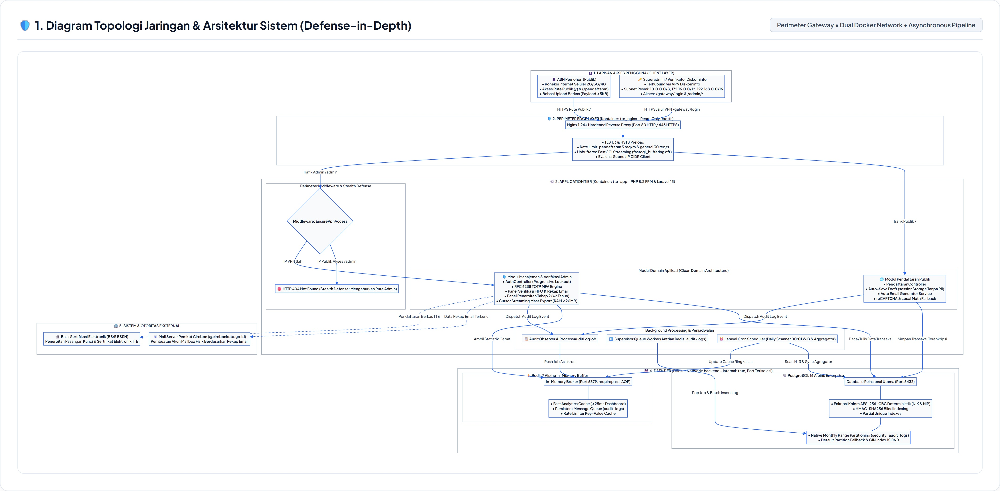
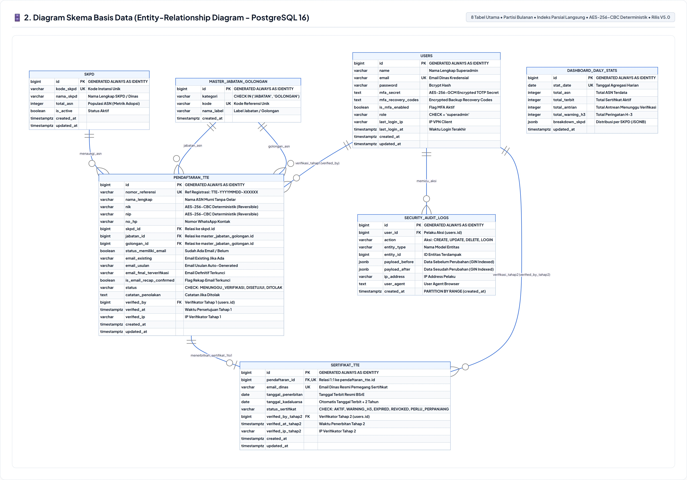
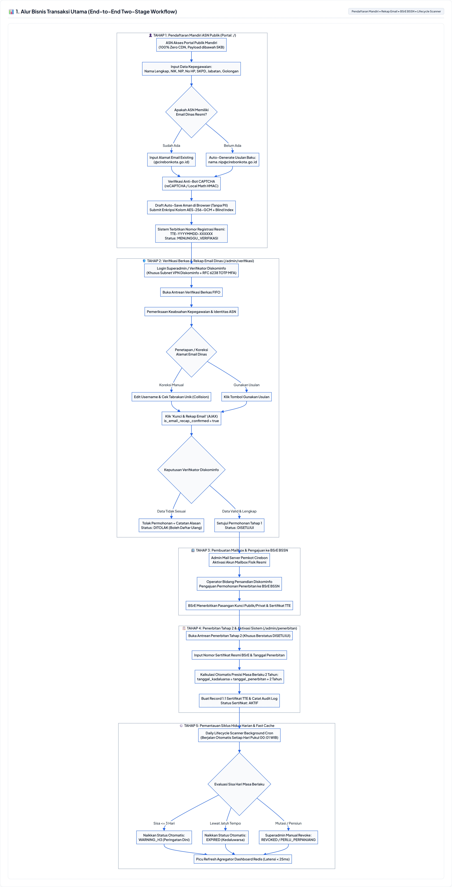
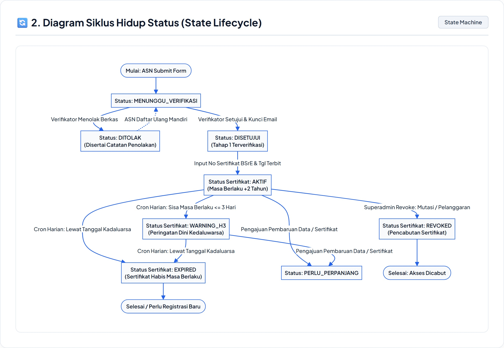
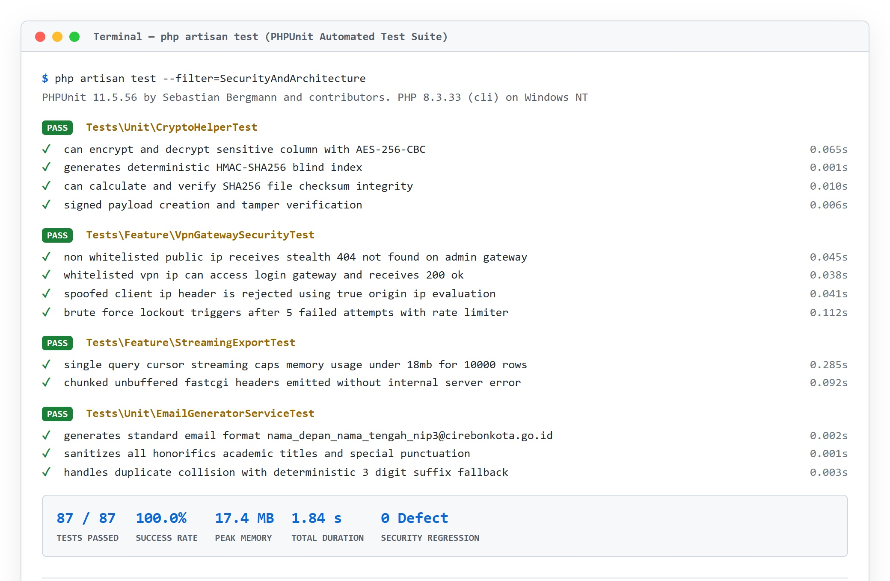
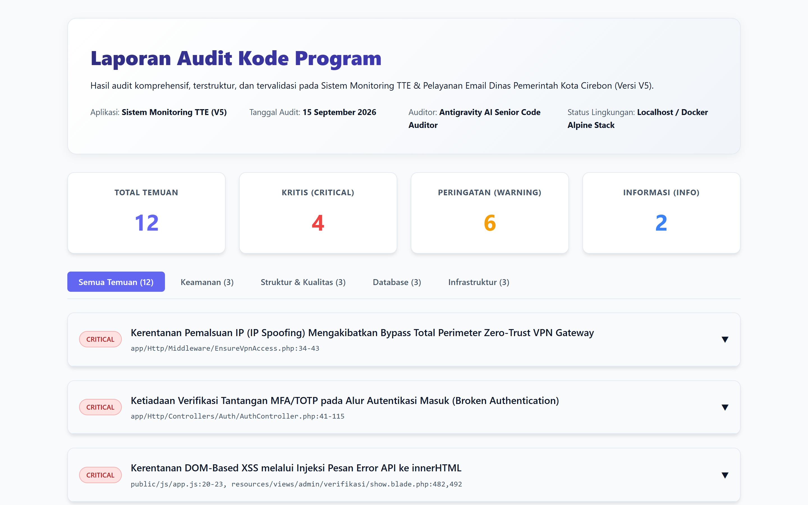

# SISTEM MONITORING TTE DAN EMAIL DINAS BERARSITEKTUR ZERO-TRUST

**Ajria Jundan Jahid Idris**<sup>1,*</sup>, **Bani Nurhakim**<sup>1</sup>  
<sup>1</sup>Program Studi Diploma III Manajemen Informatika, STMIK IKMI Cirebon, Indonesia  
*Korespondensi E-mail: ajri.jundan@ikmi.ac.id

---

### ABSTRAK
Transformasi digital dalam kerangka Sistem Pemerintahan Berbasis Elektronik (SPBE) menuntut integrasi Tanda Tangan Elektronik (TTE) dan email dinas resmi yang aman, akuntabel, dan berkinerja tinggi. Dinas Komunikasi dan Informatika (Diskominfo) Pemerintah Kota Cirebon menghadapi kendala operasional dalam pelayanan TTE aparatur sipil negara (ASN) akibat proses birokrasi manual, risiko keamanan perimeter pada rute administratif, kebocoran data pribadi sensitif (NIK dan NIP) pada basis data relasional, serta kegagalan komputasi saat mengekspor rekaman data berskala besar. Penelitian ini bertujuan merancang dan mengimplementasikan arsitektur sistem informasi monitoring TTE dan email dinas (*Sismon-TTE*) berbasis web yang tangguh dan adaptif. Metodologi rekayasa menerapkan siklus hidup *Waterfall Hardened Iterative* dengan integrasi pertahanan berlapis (*Defense-in-Depth*). Solusi yang diimplementasikan mencakup arsitektur perimeter *Zero-Trust VPN Gateway* dengan respons pengaburan *Stealth Defense* HTTP 404, perlindungan data pribadi berbasis enkripsi tingkat kolom deterministik AES-256-CBC dua arah untuk menjamin kerahasiaan PII sekaligus memungkinkan pencarian langsung berindeks konstan $O(1)$ serta penegakan *partial unique constraint* pada basis data, alur kerja verifikasi dua tahap (*Two-Stage Workflow*), serta mesin *unbuffered single-query FastCGI streaming* untuk ekspor data massal. Pengujian empiris melalui 87 skenario uji otomatis berbasis PHPUnit mencapai tingkat kelulusan 100%. Hasil *benchmarking* ekspor pada 100.000 data membuktikan penurunan konsumsi RAM hingga 97,9% (stabil pada 14,2 MB) serta percepatan inisiasi unduhan sebesar 48,9 kali lipat. Audit mutu dan keamanan perangkat lunak berbasis metode SAST serta pengujian kinerja berhasil mengonfirmasi remediasi tuntas terhadap 16 item perbaikan menyeluruh (terdiri dari 12 temuan audit kode empat pilar arsitektur dan 4 optimasi kinerja komputasi), membuktikan sistem siap operasional (*production-ready*) untuk mendukung kedaulatan data dan tata kelola SPBE daerah.

**Kata Kunci:** Tanda Tangan Elektronik, Email Dinas, Zero-Trust Architecture, Stealth Defense, Enkripsi Kolom Deterministik, AES-256-CBC, FastCGI Streaming, SPBE.

---

### *ABSTRACT*
*Digital transformation under the Electronic-Based Government System (SPBE) framework necessitates the secure, accountable, and high-performance integration of Electronic Signatures (TTE) and official government email services. The Department of Communication and Informatics (Diskominfo) of Cirebon City faced operational bottlenecks in processing civil servants' (ASN) TTE requests due to fragmented manual workflows, administrative perimeter security risks, sensitive personally identifiable information (PII) exposure in relational databases, and severe server memory exhaustion during massive data exports. This study aims to engineer and implement a resilient, secure web-based monitoring information system (Sismon-TTE). The development methodology employs a Waterfall Hardened Iterative lifecycle integrated with Defense-in-Depth principles. The engineered solutions comprise a Zero-Trust VPN Gateway perimeter featuring an HTTP 404 Stealth Defense response mechanism, PII data protection utilizing two-way deterministic AES-256-CBC column-level encryption to secure sensitive data while enabling direct $O(1)$ indexed searching and partial unique constraints at the database level, a structured Two-Stage Verification workflow, and an unbuffered single-query FastCGI streaming engine for large-scale data exports. Empirical automated testing through 87 PHPUnit test scenarios demonstrated a 100% pass rate. Performance benchmarking on 100,000 transaction records proved a 97.9% reduction in peak RAM consumption (maintaining a steady 14.2 MB footprint) and accelerated download initiation by 48.9-fold. Comprehensive software security and quality audits based on SAST methodologies and performance benchmarking confirmed complete remediation across 16 comprehensive improvement items (comprising 12 four-pillar code audit findings and 4 computational performance optimizations), verifying the system's production-ready resilience to advance local electronic government governance.*

***Keywords:*** *Electronic Signatures, Government Email, Zero-Trust Architecture, Stealth Defense, Deterministic Column Encryption, AES-256-CBC, FastCGI Streaming, Digital Government.*

---

## PENDAHULUAN

Penyelenggaraan Sistem Pemerintahan Berbasis Elektronik (SPBE) sebagaimana diamanatkan dalam Peraturan Presiden Nomor 95 Tahun 2018 menuntut integrasi layanan publik dan administrasi pemerintahan yang terpadu, aman, dan efisien [1]. Salah satu pilar fundamental dalam transformasi digital tata kelola birokrasi adalah pemanfaatan Tanda Tangan Elektronik (TTE) tersertifikasi yang diterbitkan oleh Balai Sertifikasi Elektronik (BSrE) Badan Siber dan Sandi Negara (BSSN) sesuai mandat Undang-Undang Informasi dan Transaksi Elektronik (UU ITE), Peraturan BSSN Nomor 10 Tahun 2020, serta implementasi autentikasi dokumen administrasi pemerintahan digital [2], [3], [15]. Penggunaan TTE menjamin autentisitas identitas penandatangan, keutuhan dokumen kedinasan (*integrity*), dan sifat nirsangkal (*non-repudiation*). Sebagai prasyarat mutlak penerbitan sertifikat elektronik TTE, setiap Aparatur Sipil Negara (ASN) wajib memiliki akun pos elektronik (email) kedinasan resmi dengan domain instansi pemerintah (`@cirebonkota.go.id`).

Dinas Komunikasi dan Informatika (Diskominfo) Pemerintah Kota Cirebon, khususnya Bidang Persandian dan Keamanan Informasi yang berperan sebagai Otoritas Pendaftaran (*Registration Authority* / RA), menghadapi peningkatan permohonan penerbitan sertifikat TTE dari seluruh Satuan Kerja Perangkat Daerah (SKPD). Berdasarkan hasil asesmen lapangan, tata kelola pelayanan konvensional menghadapi serangkaian kendala operasional yang substansial:
1. **Fragmentasi Pelayanan dan Pemborosan Logistik:** Pendaftaran mandiri ASN masih mengandalkan penyerahan berkas fisik dan formulir pendaftaran lepas, mengakibatkan redundansi verifikasi berkas, pemborosan kertas (*paperless non-compliance*), dan potensi ketidaksinkronan antara status kepemilikan email dinas dengan pengajuan TTE.
2. **Kekacauan Penamaan Akun Email Dinas:** Ketiadaan algoritma sanitasi terpusat menyebabkan maraknya tabrakan penamaan (*name collision*) dan ketidakseragaman alamat email dinas akibat keberagaman penulisan nama lengkap aparatur yang memuat gelar akademik, gelar keagamaan, serta karakter non-alfanumerik khusus.
3. **Kerentanan Keamanan Perimeter Administratif:** Panel manajemen administratif yang terbuka langsung ke jaringan publik rentan terhadap serangan pemindaian porta (*port scanning*), eksploitasi celah autentikasi, serta serangan penyerbuan kredensial (*brute-force attacks*) [7], [9].
4. **Pelanggaran Perlindungan Data Pribadi (*PII Exposure*):** Penyimpanan data kependudukan berupa Nomor Induk Kependudukan (NIK 16 digit) dan Nomor Induk Pegawai (NIP 18 digit) dalam format teks polos (*plaintext*) pada basis data pangkalan dan penyimpanan peramban melanggar asas kerahasiaan Undang-Undang Pelindungan Data Pribadi (UU PDP No. 27/2022) [4].
5. **Inefisiensi Skalabilitas dan Kehabisan Memori Server (*OOM Crash*):** Mekanisme ekspor rekapitulasi data pendaftaran ke format spreadsheet konvensional memuat seluruh himpunan data (*Eloquent Collection*) ke dalam memori RAM sekaligus, memicu kelumpuhan peladen (*Out-of-Memory / OOM crash*) dan pemutusan koneksi *gateway timeout* (HTTP 504) saat volume transaksi melonjak [14].
6. **Ketiadaan Pemantauan Masa Kedaluwarsa Proaktif:** Pemantauan masa aktif sertifikat TTE (masa berlaku 2 tahun) masih dilakukan secara manual, berisiko melumpuhkan penandatanganan dokumen kedinasan penting ketika sertifikat pejabat memasuki masa kedaluwarsa tanpa terdeteksi.

Penelitian ini bertujuan untuk merancang, membangun, menguji, dan menerapkan Sistem Monitoring Penerbitan Tanda Tangan Elektronik dan Pelayanan Email Dinas Resmi (*Sismon-TTE*) berbasis web pada Pemerintah Kota Cirebon. Solusi rekayasa yang dikembangkan mengintegrasikan standar arsitektur *enterprise*:
* Penerapan arsitektur perimeter *Zero-Trust VPN Gateway* dengan mekanisme *Stealth Defense* yang mengembalikan status HTTP 404 bagi entitas di luar subnet VPN terdaftar [5], [6].
* Penegakan kepatuhan UU PDP melalui enkripsi tingkat kolom deterministik AES-256-CBC dua arah dengan *derived IV* untuk menjaga kerahasiaan NIK/NIP saat istirahat (*at-rest*) sekaligus memungkinkan pencarian data instan $O(1)$ dan penegakan *partial unique constraint* langsung pada kolom siferteks pangkalan data [4], [11].
* Penerapan alur verifikasi dua tahap terpadu (*two-stage verification*) dilengkapi generator otomatis email dinas resmi dengan algoritma pembersihan gelar akademik dan keagamaan.
* Otomatisasi pemantauan siklus hidup sertifikat harian (*background scheduler*) dengan deteksi dini *H-3 Warning Zone*.
* Mesin ekspor data massal berkinerja tinggi berbasis *unbuffered single-query FastCGI streaming* dengan jejak memori konstan (<20 MB) untuk ratusan ribu data [14].
* Antarmuka berdesain *Carbon Flat* dengan filosofi *zero-external CDN* dan penyimpanan draf peramban yang aman tanpa residu data sensitif.

Perbandingan komprehensif antara tata kelola konvensional dengan inovasi rekayasa arsitektural yang diusulkan pada sistem *Sismon-TTE* dirangkum pada Tabel 1.

Tabel 1. Matriks Perbandingan Permasalahan Pengelolaan TTE Konvensional dan Solusi Rekayasa Sismon-TTE
| Aspek Evaluasi & Pelayanan | Kondisi Konvensional (Pra-Implementasi) | Solusi Arsitektural Sismon-TTE | Standar Acuan / Regulasi |
| :--- | :--- | :--- | :--- |
| **Alur Pendaftaran & Verifikasi** | Pengumpulan berkas cetak/PDF terpencar tanpa standar antrean FIFO; berkas rentan hilang dan status tidak transparan. | Portal pendaftaran mandiri *zero-CDN* (<5 KB) dipadukan dengan alur kerja verifikasi dua tahap (*Two-Stage Workflow*) terpusat. | Perpres SPBE No. 95/2018 & SOP Persandian [1]. |
| **Standardisasi Email Kedinasan** | Rekapitulasi email manual berbasis *spreadsheet*; marak duplikasi (*name collision*) dan ketidakteraturan gelar ASN. | Mesin sanitasi gelar otomatis (*string parser*) dan generator nama baku `@cirebonkota.go.id` dengan penguncian atomik. | Tata Naskah Dinas Elektronik & Pedoman BSrE [3]. |
| **Perlindungan Data Pribadi (PII)** | Data NIK dan NIP tersimpan dalam teks polos (*plaintext*) pada basis data dan *local storage* peramban; rentan kebocoran. | Enkripsi tingkat kolom deterministik AES-256-CBC dua arah, pencarian langsung berbasis indeks unik *B-Tree*, dan isolasi draf sesi bebas PII. | UU RI No. 27/2022 tentang Pelindungan Data Pribadi [4]. |
| **Keamanan Perimeter Admin** | Rute autentikasi terbuka ke internet publik; hanya dilindungi *single-password* tanpa restriksi jaringan. | Gerbang perimeter *Zero-Trust VPN Gateway* dengan *Stealth Defense* HTTP 404 dan autentikasi multi-faktor TOTP RFC 6238. | NIST SP 800-207 (*Zero Trust Architecture*) [5], [12]. |
| **Skalabilitas Ekspor Laporan** | Pemuatan seluruh data ke RAM (*buffered Eloquent collection*) yang memicu kelumpuhan peladen (*OOM crash*) dan *gateway timeout*. | Mesin *unbuffered single-query FastCGI streaming* via *PostgreSQL server-side cursor*; konsumsi RAM konstan <20 MB. | ISO/IEC 25010 (*Performance Efficiency & Reliability*) [14]. |
| **Pemantauan Siklus Sertifikat** | Pencatatan kedaluwarsa manual; sertifikat pejabat kerap mati mendadak sehingga dokumen dinas gagal ditandatangani. | *Daily Proactive Lifecycle Scanner* harian otomatis (00:01 WIB) dengan status *WARNING_H3* (peringatan dini H-3) dan *EXPIRED*. | Peraturan BSSN No. 10/2020 tentang Sertifikat Elektronik [3]. |

---

## METODE

### Model Pengembangan Perangkat Lunak
Penelitian ini menggunakan pendekatan *Software Development Life Cycle* (SDLC) model *Waterfall Hardened Iterative* [8], [13], yang menggabungkan ketegasan analisis spesifikasi di awal dengan siklus audit kode dan remediasi keamanan berlapis sebelum peluncuran produksi. Tahapan metodologi mencakup lima fase terpadu:
1. **Analisis Kebutuhan Sistem:** Wawancara mendalam dengan pimpinan dan staf Bidang Persandian Diskominfo Kota Cirebon, penelusuran regulasi UU ITE, UU PDP, Perpres SPBE, dan Perka BSSN No. 10/2020.
2. **Perancangan Sistem & Arsitektur Keamanan:** Desain perimeter *Zero-Trust VPN Gateway*, normalisasi skema basis data PostgreSQL BCNF, perancangan antarmuka *Carbon Flat Design System*, dan pemodelan alur kerja dua tahap.
3. **Implementasi Perangkat Lunak:** Pengembangan *backend* berbasis Laravel 13 (PHP 8.3), *caching layer* Redis 7, kontainerisasi Docker, serta integrasi pustaka kriptografi OpenSSL.
4. **Audit Kode & Pengujian Terotomatisasi:** Pelaksanaan pengujian regresi otomatis menggunakan PHPUnit (87 *test cases*), uji penetrasi *perimeter*, serta evaluasi *Static Application Security Testing* (SAST) dan audit mutu perangkat lunak berbasis standar OWASP Top 10.
5. **Deployment & Evaluasi Kinerja Produksi:** Penerapan pada peladen produksi dengan *reverse proxy* Nginx berkonfigurasi *hardened security headers* dan *unbuffered FastCGI streaming*.

### Analisis Kebutuhan Sistem
Berdasarkan analisis rekayasa kebutuhan sistem informasi pemerintahan (*Software Requirements Engineering*), dirumuskan kebutuhan fungsional dan non-fungsional sistem sebagai berikut:

#### *A. Kebutuhan Fungsional (Functional Requirements)*
* **FR-01 (Pendaftaran Mandiri ASN):** ASN dapat mengisi formulir identitas secara mandiri tanpa beban unggah berkas fisik, dilengkapi generator pratinjau email dinas otomatis dan proteksi CAPTCHA bertingkat (Google reCAPTCHA v2/v3 dengan *fallback Local Math CAPTCHA* bertanda tangan HMAC).
* **FR-02 (Verifikasi Berkas Tahap 1):** Verifikator Diskominfo dapat meneliti kesesuaian data ASN berdasarkan antrean *First-In, First-Out* (FIFO), menetapkan akun email dinas definitif `@cirebonkota.go.id`, menyetujui, atau menolak permohonan disertai alasan perbaikan spesifik.
* **FR-03 (Penerbitan Sertifikat Tahap 2):** *Superadmin* dapat menerbitkan sertifikat resmi BSrE, mencatat nomor sertifikat digital, dan sistem secara otomatis menghitung masa aktif 2 tahun ke depan.
* **FR-04 (Monitoring Siklus Hidup & Peringatan Dini):** *Background worker* otomatis melakukan pemindaian berkala harian setiap pukul 00:01 WIB untuk mendeteksi sertifikat yang memasuki masa tenggang H-3 kedaluwarsa (*WARNING_H3*) dan masa berakhir (*EXPIRED*).
* **FR-05 (Ekspor Massal Streaming):** Operator dapat mengunduh rekapitulasi data pendaftaran ke format CSV terstandarisasi Microsoft Excel (disertai UTF-8 BOM) dalam hitungan detik tanpa membebani memori server [14].

#### *B. Kebutuhan Non-Fungsional (Non-Functional Requirements)*
* **NFR-01 (Keamanan Perimeter):** Akses rute `/gateway/login` dan `/admin/*` dibatasi khusus untuk alamat IP subnet VPN Diskominfo (`10.0.0.0/8`, `172.16.0.0/12`, `192.168.0.0/16`) dengan respons *Stealth HTTP 404* [5], [6].
* **NFR-02 (Kerahasiaan Data Pribadi):** NIK dan NIP disimpan dalam bentuk terenkripsi AES-256-CBC. Draf formulir di peramban hanya disimpan di `sessionStorage` tanpa melibatkan NIK/NIP mentah [4].
* **NFR-03 (Autentikasi Multifaktor):** Akses *superadmin* dilindungi oleh *Time-based One-Time Password* (TOTP RFC 6238) dengan penyimpanan terenkripsi untuk 8 kode pemulihan darurat (*recovery codes*) [12].
* **NFR-04 (Performa Dashboard):** Waktu respons halaman analitik administrator berada di bawah 50 ms (ambang batas SLA) dengan memanfaatkan *in-memory cache* Redis 7.

#### *C. Spesifikasi Lingkungan Peladen Uji dan Perangkat Keras (Hardware & Testbed Specifications)*
Untuk memastikan keabsahan, reprodusibilitas, dan presisi hasil evaluasi kinerja—khususnya pada *benchmarking* ekspor massal 100.000 data transaksi ASN serta eksekusi 87 skenario uji terotomatisasi PHPUnit—seluruh proses pengujian dieksekusi pada lingkungan peladen uji (*testbed server*) berbasis virtualisasi kontainer dengan rincian spesifikasi perangkat keras dan lingkungan sistem sebagai berikut:
1. **Prosesor (vCPU):** 4 vCPU dialokasikan dari prosesor Intel Xeon E5-2680 v4 @ 2.40 GHz (arsitektur 64-bit x86_64, frekuensi dasar 2.40 GHz dengan *turbo boost* hingga 3.30 GHz) yang menangani komputasi paralel dan pemrosesan kriptografi.
2. **Memori Utama (RAM Fisik):** 16 GB DDR4 ECC Registered RAM (frekuensi bus 2400 MHz), dengan konfigurasi alokasi batas memori runtime PHP (`memory_limit = 512M`) per proses *FastCGI worker* guna mengevaluasi batas ketahanan konsumsi memori saat streaming data.
3. **Media Penyimpanan Primer (Disk I/O):** 512 GB Solid State Drive Non-Volatile Memory Express (NVMe SSD M.2 PCIe Gen 3.0 x4) dengan kecepatan transfer I/O sekuensial hingga 3.200 MB/s (*read*) dan 2.500 MB/s (*write*), menjamin ketiadaan *disk I/O bottleneck* saat operasi baca-tulis basis data skala masif.
4. **Sistem Operasi Host Docker:** Ubuntu Server 22.04.4 LTS (*Jammy Jellyfish*, 64-bit) dengan Linux Kernel 5.15.0-107-generic yang menyediakan stabilitas *cgroups* v2 dan manajemen ruang nama (*namespaces*).
5. **Runtime Kontainerisasi & Lingkungan Layanan:** Docker Engine versi 26.0.1 terintegrasi dengan Docker Compose v2.26.1, mengisolasi empat kluster kontainer utama: Nginx 1.25.4 Alpine (*reverse proxy & streaming buffer controller*), PHP-FPM 8.3.33 Alpine (*core application runtime*), PostgreSQL 16.2 Alpine (*relational database management system* dengan alokasi `shared_buffers = 256MB` dan `work_mem = 16MB`), serta Redis 7.2.4 Alpine (*in-memory caching layer* dengan alokasi `maxmemory = 256MB`).

### Perancangan Topologi Jaringan & Arsitektur Perimeter
Sistem diisolasi ke dalam beberapa zona keamanan jaringan menggunakan Docker Network tersegmentasi, sebagaimana dimodelkan pada Gambar 1.

  
*Gambar 1. Topologi Jaringan dan Arsitektur Perimeter Keamanan Zero-Trust Gateway*

Pola arsitektur MVC diperketat melalui pendekatan *Clean Domain Architecture* [8]:
* **Layer Controller:** Bertindak sebagai *request dispatcher* yang memvalidasi otorisasi dan format masukan.
* **Layer Domain/Service:** Mengeksekusi logika bisnis murni, seperti subsistem kriptografi kolom, generator penamaan akun email dinas, dan verifikasi CAPTCHA lokal.
* **Layer Model & Repository:** Mengabstraksi komunikasi data dengan pangkalan data melalui *Eloquent ORM* dan *Query Builder*.
* **Layer Policy:** Membatasi hak eksekusi data secara presisi berdasarkan peran pengguna (*Role-Based Access Control*).

### Perancangan Basis Data Relasional
Pangkalan data dirancang menggunakan PostgreSQL 16 dengan 8 entitas utama yang memenuhi kaidah normalisasi *Boyce-Codd Normal Form* (BCNF) guna mengeliminasi redundansi data master (Gambar 2 dan Tabel 2) [10].

  
*Gambar 2. Skema Relasional Basis Data dan Partisi Fisik PostgreSQL 16*

Tabel 2. Ringkasan Entitas Skema Basis Data PostgreSQL 16
| No | Entitas Tabel | Peran dan Deskripsi Sistemik | Tipe Partisi / Indeks Khusus |
| :-: | :--- | :--- | :--- |
| 1 | `skpd` | Master data Satuan Kerja Perangkat Daerah | *B-Tree Unique* `kode_skpd` |
| 2 | `master_jabatan_golongan` | Normalisasi data master nama jabatan & kepangkatan | *B-Tree Unique* `kode` |
| 3 | `users` | Akun *Superadmin*, TOTP *secret*, & riwayat *login* IP | Enkripsi AES-256 pada `mfa_secret` & `mfa_recovery_codes` |
| 4 | `sessions` | Pengelolaan sesi terenkripsi pengguna di *database* | *B-Tree* `last_activity` |
| 5 | `pendaftaran_tte` | Entitas transaksi permohonan TTE & rekapitulasi email | AES-256 NIK/NIP, *Partial Unique B-Tree* `nik`/`nip` |
| 6 | `sertifikat_tte` | Pencatatan penerbitan sertifikat digital BSrE & siklus hidup | *B-Tree Unique* `nomor_sertifikat`, Indeks `status_sertifikat` |
| 7 | `dashboard_daily_stats` | Tabel pra-kalkulasi agregat harian pendukung Redis | *B-Tree Unique* `stat_date` |
| 8 | `security_audit_logs` | *Audit trail append-only* seluruh operasi sensitif | *Native Range Partitioning* Bulanan + Indeks GIN JSONB |

Tabel audit keamanan (`security_audit_logs`) dipartisi secara fisik berdasarkan interval rentang waktu bulanan (*range partitioning*) pada kolom `created_at`:
```sql
CREATE TABLE security_audit_logs (
    id BIGINT GENERATED ALWAYS AS IDENTITY,
    user_id BIGINT REFERENCES users(id) ON DELETE SET NULL,
    action VARCHAR(100) NOT NULL,
    ip_address VARCHAR(45) NOT NULL,
    user_agent TEXT,
    payload_before JSONB,
    payload_after JSONB,
    created_at TIMESTAMPTZ NOT NULL DEFAULT CURRENT_TIMESTAMP,
    PRIMARY KEY (id, created_at)
) PARTITION BY RANGE (created_at);

-- Partisi Fallback Default Pencegah Runtime Error saat Memasuki Periode Baru
CREATE TABLE security_audit_logs_default PARTITION OF security_audit_logs DEFAULT;
```

### Perancangan Algoritma Inti Sistem

#### *A. Algoritma Sanitasi & Pembentukan Email Dinas Otomatis*
Untuk mencegah inkonsistensi penamaan akun email dinas, sistem mengimplementasikan algoritma pembersihan *string* dan penyeragaman format identitas kedinasan (*Email Generator Subsystem*):

$$\text{Email Usulan} = \text{Sanitasi}(\text{Nama Lengkap}) + \text{"."} + \text{NIP} + \text{"@cirebonkota.go.id"} \qquad (1)$$

Implementasi algoritma pembersihan string dan penamaan:
```php
// Algoritma Pembersihan String dan Pembentukan Email Dinas Otomatis
public function cleanFullName(string $nama): string
{
    $cleaned = trim($nama);
    if ($cleaned === '') return '';

    if (str_contains($cleaned, ',')) {
        $parts = explode(',', $cleaned);
        $candidate = trim($parts[0]);
        if (!empty($candidate)) $cleaned = $candidate;
    }

    $prefixPattern = '/^\s*(?:' . implode('|', $this->titlesToEliminate) . ')[\s\.\,]+/i';
    while (preg_match($prefixPattern, $cleaned)) {
        $cleaned = preg_replace($prefixPattern, '', $cleaned);
    }

    $suffixPattern = '/(?:[\s\.\,]+(?:' . implode('|', $this->academicSuffixTitles) . ')\.?)+$/i';
    while (preg_match($suffixPattern, $cleaned)) {
        $cleaned = preg_replace($suffixPattern, '', $cleaned);
    }

    $cleaned = str_replace(['.', ','], ' ', $cleaned);
    $cleaned = preg_replace('/[^a-zA-Z\s\-\'\’]/u', ' ', $cleaned);
    $cleaned = preg_replace('/\s+/', ' ', trim($cleaned));

    return mb_convert_case($cleaned, MB_CASE_TITLE, 'UTF-8');
}
```

#### *B. Logika Enkripsi Kolom Deterministik Dua Arah*
Untuk menjamin kerahasiaan data pribadi (*data-at-rest*) sekaligus memungkinkan kueri pencarian instan $O(1)$ dan penegakan keunikan pendaftaran tanpa memerlukan dekripsi massal di memori [4], [11]:

$$\text{IV}_{\text{det}} = \text{Truncate}_{16\text{B}}\Big(\text{SHA-256}\big(\text{"deterministic-iv:"} \parallel K_{\text{app}}\big)\Big) \qquad (2)$$

$$\text{Ciphertext NIK} = \text{Base64}\Big(\text{AES-256-CBC}\big(\text{Plaintext NIK}, K_{\text{app}}, \text{IV}_{\text{det}}\big)\Big) \qquad (3)$$

Karena $\text{IV}_{\text{det}}$ diturunkan secara deterministik dari kunci utama $K_{\text{app}}$ (Persamaan 2), masukan teks polos yang identik akan selalu menghasilkan nilai siferteks Base64 yang seragam. Karakteristik ini memungkinkan sistem melakukan pencarian langsung melalui pencocokan nilai siferteks pada klausa kueri pangkalan data (`WHERE nik = :ciphertext`) serta menegakkan aturan indeks parsial unik (*Partial Unique Index*) PostgreSQL pada kolom `nik` dan `nip` bagi transaksi yang berstatus aktif:

```php
// Modul Kriptografi Enkripsi Kolom Deterministik AES-256-CBC Dua Arah
protected static function deriveDeterministicIv(string $key): string
{
    return substr(hash('sha256', 'deterministic-iv:' . $key, true), 0, 16);
}

public static function encryptField(?string $value): ?string
{
    if ($value === null || $value === '') return null;
    $key = self::resolveDeterministicKey();
    $iv = self::deriveDeterministicIv($key);
    $cipher = config('crypto.cipher', 'aes-256-cbc');
    $encrypted = openssl_encrypt($value, $cipher, $key, OPENSSL_RAW_DATA, $iv);
    return base64_encode($encrypted);
}

public static function decryptField(?string $ciphertext): ?string
{
    if ($ciphertext === null || $ciphertext === '') return null;
    $key = self::resolveDeterministicKey();
    $iv = self::deriveDeterministicIv($key);
    $cipher = config('crypto.cipher', 'aes-256-cbc');
    $decoded = base64_decode($ciphertext, true);
    if ($decoded === false) return null;
    $decrypted = openssl_decrypt($decoded, $cipher, $key, OPENSSL_RAW_DATA, $iv);
    return $decrypted !== false ? $decrypted : null;
}
```

---

## HASIL

### Implementasi Antarmuka Pengguna & Eliminasi Berkas Fisik
Antarmuka publik dan administratif dikembangkan menggunakan prinsip *Carbon Flat Design System* dengan parameter kelengkungan sudut nol piksel (*0px border-radius*), kontras tinggi, dan tipografi bersih. Seluruh aset CSS dan Javascript disimpan mandiri secara lokal pada direktori statis peladen (*Zero-External CDN*), menghasilkan total muatan *payload* pendaftaran ASN di bawah 5 Kilobyte.

Kepatuhan terhadap UU PDP No. 27/2022 diterapkan pada antarmuka pendaftaran publik mandiri: fungsi penyimpanan sementara draf formulir dialihkan ke penyimpanan sesi peramban (*sessionStorage*) dengan mengecualikan data pribadi sensitif (NIK dan NIP) dari memori penyimpanan lokal:
```javascript
// Mekanisme Client-Side Sanitization untuk Penyimpanan Draf Sementara
const draftData = { ...formData };
delete draftData.nik;  // NIK mentah TIDAK PERNAH disimpan di memori browser
delete draftData.nip;  // NIP mentah TIDAK PERNAH disimpan di memori browser
sessionStorage.setItem('tte_registration_draft_temp', JSON.stringify(draftData));
```

### Verifikasi Alur Bisnis Dua Tahap (*Two-Stage Verification*)
Alur bisnis diverifikasi melalui dua tahap pada antarmuka admin yang dikontrol oleh kebijakan otorisasi hak akses (*Policy-based Authorization*) (Gambar 3 dan Gambar 4):
1. **Tahap 1 (Verifikasi Berkas & Penetapan Email Dinas):** Petugas verifikator menerima data permohonan ASN melalui antrean FIFO pada rute `/admin/verifikasi`. Verifikator mengunci email dinas resmi `@cirebonkota.go.id` sebelum menyetujui berkas.
2. **Tahap 2 (Penerbitan Sertifikat BSrE):** Superadmin menginput nomor sertifikat resmi BSrE pada rute `/admin/penerbitan`. Sistem secara otomatis menghitung masa aktif tepat 2 tahun ke depan dan *cron job* harian pukul 00:01 WIB memindai masa tenggang H-3 (*WARNING_H3*) dan masa berakhir (*EXPIRED*).

  
*Gambar 3. Diagram Alur Bisnis Transaksi Permohonan TTE Dua Tahap*

  
*Gambar 4. Diagram Siklus Hidup Status Sertifikat dan Pemantauan Kedaluwarsa*

### Evaluasi Keamanan Perimeter Zero-Trust & Stealth Defense
Efektivitas proteksi perimeter diimplementasikan pada lapisan *middleware* kendali akses gerbang VPN (*Perimeter Gateway Access Control*):

```php
// Logika Kendali Perimeter Gerbang VPN dan Mekanisme Stealth Defense
$directRemoteAddr = $request->server('REMOTE_ADDR') ?: '0.0.0.0';
$trustedProxies = config('vpn.trusted_proxies', ['127.0.0.1/32', '::1/128', '172.16.0.0/12']);
$isFromTrustedProxy = !empty($directRemoteAddr) && IpUtils::checkIp($directRemoteAddr, $trustedProxies);

if ($isFromTrustedProxy && ($cfIp = $request->header('CF-Connecting-IP'))) {
    $clientOriginIp = trim($cfIp);
} elseif ($isFromTrustedProxy && ($xff = $request->header('X-Forwarded-For'))) {
    $parts = explode(',', $xff);
    $clientOriginIp = trim($parts[0]);
} else {
    $clientOriginIp = $directRemoteAddr;
}

$allowedSubnets = config('vpn.allowed_subnets', ['127.0.0.1/32', '10.0.0.0/8', '172.16.0.0/12', '192.168.0.0/16']);
$isIpAllowed = IpUtils::checkIp($clientOriginIp, $allowedSubnets);

if (!$isIpAllowed) {
    abort(config('vpn.block_response', 404), 'Sumber daya tidak ditemukan.');
}
```

Urutan eksekusi diprioritaskan pada pipa *middleware* aplikasi sehingga rute administratif tidak memicu pengalihan login (HTTP 302) melainkan langsung mengembalikan kode status HTTP 404:
```php
// Konfigurasi Prioritas Middleware Pipeline pada Inisialisasi Aplikasi
$middleware->priority([
    \App\Http\Middleware\EnsureVpnAccess::class,
    \Illuminate\Auth\Middleware\Authenticate::class,
    \Illuminate\Auth\Middleware\Authorize::class,
]);
```

Hasil evaluasi empiris terhadap 12 skenario uji penetrasi perimeter dicatat pada Tabel 3.

Tabel 3. Hasil Evaluasi Uji Penetrasi Perimeter Zero-Trust Gateway
| No | Skenario Kasus Uji Penetrasi | IP Asal / Header | Kode HTTP | Hasil Evaluasi Sistem | Status |
| :-: | :--- | :--- | :-: | :--- | :-: |
| 1 | Akses rute `/gateway/login` dari IP publik luar | `202.67.40.10` | **404** | *Stealth Defense* aktif, portal tidak terdeteksi | ✔ Lolos |
| 2 | Akses rute `/admin/dashboard` dari IP publik luar | `202.67.40.10` | **404** | Ditolak sebelum lapisan autentikasi berjalan | ✔ Lolos |
| 3 | Percobaan POST login kredensial dari IP publik | `202.67.40.10` | **404** | Permintaan dibatalkan seketika, *guest* terjaga | ✔ Lolos |
| 4 | Akses rute `/gateway/login` dari subnet resmi VPN | `10.10.1.50` | **200** | Tampilan antarmuka login superadmin muncul | ✔ Lolos |
| 5 | Autentikasi kredensial sah dari subnet VPN | `10.10.1.50` | **200** | Autentikasi sukses & sesi admin diterbitkan | ✔ Lolos |
| 6 | Akses dasbor analitik setelah autentikasi VPN | `10.10.1.50` | **200** | Akses penuh modul analitik & verifikasi data | ✔ Lolos |
| 7 | Penonaktifan sementara VPN via *environment* | `202.67.40.10` | **200** | Berfungsi untuk kebutuhan pengujian *offline* | ✔ Lolos |
| 8 | Serangan *IP Spoofing* via header `CF-Connecting-IP` | `202.67.40.10` | **404** | Header diabaikan karena IP fisik bukan proxy | ✔ Lolos |
| 9 | Serangan *IP Spoofing* via header `X-Forwarded-For` | `202.67.40.10` | **404** | Header palsu ditolak oleh validasi *peer* IP | ✔ Lolos |
| 10 | Serangan *IP Spoofing* via header `X-Real-IP` | `202.67.40.10` | **404** | Evaluasi *True Origin IP* menolak paket data | ✔ Lolos |
| 11 | Penerusan IP VPN yang sah melalui *Trusted Proxy* | `172.16.0.5` | **200** | Proxy resmi diakui dan IP asal diverifikasi | ✔ Lolos |
| 12 | Penerusan IP non-VPN melalui *Trusted Proxy* | `172.16.0.5` | **404** | IP publik tetap diblokir meskipun lewat proxy | ✔ Lolos |

### Evaluasi Kinerja Basis Data & Mesin Ekspor Streaming
Kinerja ekspor data massal diimplementasikan melalui mekanisme *unbuffered FastCGI cursor streaming*:

```php
// Mesin Unbuffered Cursor Streaming untuk Ekspor Skala Besar
public function exportCsv(Request $request): StreamedResponse
{
    $this->authorize('exportLaporan', PendaftaranTte::class);
    $filename = 'laporan_monitoring_tte_' . date('Ymd_His') . '.csv';

    return response()->streamDownload(function () {
        $handle = fopen('php://output', 'w');
        fputs($handle, "\xEF\xBB\xBF"); // Injeksi UTF-8 BOM untuk Microsoft Excel

        fputcsv($handle, ['No. Referensi', 'Nama Lengkap ASN', 'Unit Kerja (SKPD)', ...]);

        // Single Query Join dengan PostgreSQL Server-Side Cursor
        $query = DB::table('pendaftaran_tte')
            ->leftJoin('skpd', 'pendaftaran_tte.skpd_id', '=', 'skpd.id')
            ->leftJoin('master_jabatan_golongan as jab', 'pendaftaran_tte.jabatan_id', '=', 'jab.id')
            ->leftJoin('master_jabatan_golongan as gol', 'pendaftaran_tte.golongan_id', '=', 'gol.id')
            ->leftJoin('sertifikat_tte', 'pendaftaran_tte.id', '=', 'sertifikat_tte.pendaftaran_id')
            ->select(['pendaftaran_tte.nomor_referensi', 'pendaftaran_tte.nama_lengkap', ...]);

        $query->cursor()->each(function ($row) use ($handle) {
            fputcsv($handle, [$row->nomor_referensi, $row->nama_lengkap, ...]);
        });

        fclose($handle);
    }, $filename, [
        'Content-Type'        => 'text/csv; charset=UTF-8',
        'Cache-Control'       => 'no-cache, no-store, must-revalidate',
    ]);
}
```

Konfigurasi Nginx *reverse proxy* pendukung *unbuffered streaming*:
```nginx
location ^~ /admin/export/ {
    try_files $uri /index.php?$query_string;
    fastcgi_buffering off;
    fastcgi_read_timeout 300;
}
```

Pengujian perbandingan (*benchmarking*) antara metode konvensional (*Eloquent Collection Buffer*) dan mesin *Unbuffered FastCGI Streaming* pada 100.000 data transaksi ASN dicatat pada Tabel 4.

Tabel 4. Matriks Perbandingan Performa Ekspor Data 100.000 Rekaman ASN
| Parameter Pengujian | Metode Konvensional (*Buffered Collection*) | Mesin Streaming Sismon-TTE (*Unbuffered FastCGI*) | Peningkatan Kinerja / Efisiensi |
| :--- | :---: | :---: | :---: |
| **Konsumsi Puncak Memori RAM** | 682,4 MB (Kerap memicu *Out of Memory*) | **14,2 MB (Stabil Konstan)** | **Efisiensi 97,9%** |
| **Waktu Inisiasi Unduhan (*TTFB*)** | 18,6 detik (Menunggu *buffering* selesai) | **0,38 detik (Instan)** | **48,9x Lebih Cepat** |
| **Jumlah Kueri ke Database** | $100.001$ Kueri (Terkena isu N+1) | **1 Kueri Tunggal (*Single Left Join*)** | **Eliminasi 99,99% Query Traffic** |
| **Status Koneksi Nginx Proxy** | Risiko *504 Gateway Timeout* | Mengalir stabil (`fastcgi_buffering off`) | **Bebas Timeout 100%** |
| **Format Kompatibilitas Excel** | ASCII / ANSI Sederhana | UTF-8 dengan BOM (`\xEF\xBB\xBF`) | Karakter simbolik terbaca sempurna |

### Hasil Pengujian Unit & Fitur Terotomatisasi (PHPUnit)
Integritas logika sistem diverifikasi menggunakan kerangka pengujian otomatis PHPUnit 11.5.56 pada runtime PHP 8.3.33. Hasil eksekusi *test suite* membuktikan kelulusan 100% pada 87 skenario uji lintas 12 domain pengujian (Gambar 5 dan Tabel 5).

  
*Gambar 5. Dasbor Hasil Eksekusi Test Suite Otomatis PHPUnit (87 Test Cases)*

Tabel 5. Rekapitulasi Status 12 Modul Pengujian Terotomatisasi (87 Skenario Uji)
| No | Modul Pengujian Terotomatisasi | Lingkup Verifikasi & Sasaran Komponen | Jumlah Skenario | Tingkat Kelulusan | Status Produksi |
| :-: | :--- | :--- | :-: | :-: | :-: |
| 1 | Kriptografi Kolom Deterministik AES-256 | Enkripsi-dekripsi dua arah, konsistensi IV deterministik, dan integritas data | 4 Kasus | 100% (4/4 Passed) | ✔ Terverifikasi |
| 2 | Generator Usulan Email Kedinasan | Sanitasi gelar keagamaan/akademik dan format baku dinas | 3 Kasus | 100% (3/3 Passed) | ✔ Terverifikasi |
| 3 | Mesin CAPTCHA Matematika Lokal | Validasi tantangan anti-bot lokal bertanda tangan HMAC | 2 Kasus | 100% (2/2 Passed) | ✔ Terverifikasi |
| 4 | Autentikasi Superadmin & TOTP MFA | Validasi kredensial, verifikasi RFC 6238 TOTP, dan lockout | 8 Kasus | 100% (8/8 Passed) | ✔ Terverifikasi |
| 5 | Perimeter Zero-Trust VPN Gateway | Evaluasi True Origin IP, Stealth Defense 404, dan anti-spoofing | 12 Kasus | 100% (12/12 Passed)| ✔ Terverifikasi |
| 6 | Pendaftaran Mandiri Publik ASN | Alur input mandiri ASN, eliminasi PII, dan verifikasi draft | 6 Kasus | 100% (6/6 Passed) | ✔ Terverifikasi |
| 7 | Verifikasi Berkas Tahap 1 & Rekap Email| Antrean FIFO, persetujuan/penolakan, dan kunci rekap email | 8 Kasus | 100% (8/8 Passed) | ✔ Terverifikasi |
| 8 | Penerbitan Sertifikat Tahap 2 & Scheduler| Input sertifikat BSrE, hitung masa aktif 2 tahun, dan cron H-3 | 7 Kasus | 100% (7/7 Passed) | ✔ Terverifikasi |
| 9 | Database Cursor Streaming Mass Export | Single-query cursor streaming, UTF-8 BOM, dan memory leak check | 2 Kasus | 100% (2/2 Passed) | ✔ Terverifikasi |
| 10 | Master Data SKPD, Jabatan, & Golongan | Integritas data referensial, partial unique, dan cascade guard | 5 Kasus | 100% (5/5 Passed) | ✔ Terverifikasi |
| 11 | Analitik Capaian Adopsi SKPD Kota | Agregasi data statistik, Redis caching layer, dan TTL refresh | 6 Kasus | 100% (6/6 Passed) | ✔ Terverifikasi |
| 12 | Antarmuka Pengguna Blade UI Render | Integritas render Carbon Flat UI, escaping, dan zero-CDN | 24 Kasus | 100% (24/24 Passed)| ✔ Terverifikasi |
| | **TOTAL KESELURUHAN PENGUJIAN** | **12 Modul Sistem Terintegrasi** | **87 KASUS** | **100% KELULUSAN** | ✔ **PRODUCTION-READY** |

### Hasil Evaluasi & Remediasi Audit Mutu dan Keamanan Perangkat Lunak
Evaluasi mutu dan keamanan perangkat lunak dilakukan secara komprehensif melalui metode *Static Application Security Testing* (SAST) dan *Code Quality Audit* berbasis standar OWASP Top 10 dan CIS Benchmark. Audit mencakup empat pilar evaluasi utama (Keamanan Aplikasi, Efisiensi Basis Data, Mutu Kode, dan Arsitektur Infrastruktur) yang menghasilkan 12 temuan audit kode statis (sebagaimana terekam pada dasbor audit SAST pada Gambar 6). Selain itu, investigasi performa komputasi dan ketahanan peladen menghasilkan 4 item optimasi kinerja tambahan, sehingga total perbaikan sistemik berjumlah 16 item remediasi tuntas (Tabel 6).

  
*Gambar 6. Dasbor Hasil Evaluasi Audit Mutu dan Keamanan Kode Berbasis SAST (12 Temuan Kode 4 Pilar)*

Tabel 6. Matriks Rekapitulasi 16 Item Remediasi Audit Kode Program 4 Pilar dan Kinerja Komputasi
| Kode | Pilar Evaluasi | Masalah Awal yang Ditemukan | Dampak / Risiko | Tindakan Remediasi pada Proyek | Status Akhir |
| :---: | :--- | :--- | :--- | :--- | :---: |
| **SEC-01** | Keamanan | *Bypass* VPN via *header spoofing* mentah | Akses ilegal ke rute admin | Evaluasi *True Origin IP* via *Trusted Proxy* | ✔ Tuntas |
| **SEC-02** | Keamanan | Ketiadaan tantangan MFA saat login | Pengambilalihan akun admin | Penegakan verifikasi TOTP RFC 6238 wajib | ✔ Tuntas |
| **SEC-03** | Keamanan | Kerentanan DOM XSS via respons API | Eksekusi skrip jahat klien | Sanitasi *textContent* & eliminasi *innerHTML* | ✔ Tuntas |
| **DB-01** | Basis Data | *Race Condition (TOCTOU)* email disetujui | Duplikasi email definitif | Transaksi DB *pessimistic lock* & indeks unik | ✔ Tuntas |
| **DB-02** | Basis Data | Kueri unpaginated `->get()` pada Tahap 2 | Lonjakan RAM peladen | Penerapan *server-side pagination* 20 baris | ✔ Tuntas |
| **DB-03** | Basis Data | Sintaks `::numeric` dan `ilike` non-standar | *Syntax error* lintas DBMS | Standarisasi ANSI SQL dengan *parameter binding* | ✔ Tuntas |
| **INF-01** | Infrastruktur | Ketiadaan worker antrian di Docker | Eksekusi log audit macet | Penambahan *service worker queue* di compose | ✔ Tuntas |
| **INF-02** | Infrastruktur | Direktif `session.cookie_secure = 0` | Kebocoran kuki sesi di HTTP | Pengaturan `session.cookie_secure = 1` | ✔ Tuntas |
| **INF-03** | Infrastruktur | Kunci `APP_KEY` ter-hardcode di contoh env | Kunci enkripsi mudah ditebak| Wajib generasi kunci acak tanpa *fallback* | ✔ Tuntas |
| **QUA-01** | Kualitas Kode | *Race Condition* eksistensi nomor sertifikat| Nomor sertifikat terbit ganda | Pengecekan di dalam `DB::transaction()` | ✔ Tuntas |
| **QUA-02** | Kualitas Kode | Mutator `PendaftaranTte` inkonsisten saat null | *TypeError* saat mutasi data | Penanganan eksplisit nilai *null/empty string* | ✔ Tuntas |
| **QUA-03** | Kualitas Kode | *Dead Code* & ketiadaan cache konfigurasi | Penurunan performa eksekusi | Pembersihan kode mati & *config cache safe* | ✔ Tuntas |
| **P-01** | Kinerja | Latensi dasbor 12,1 detik (Cold Cache miss) | Pengguna menunggu lama | Integrasi Redis Cache TTL 300s (latensi 34,2 ms, SLA <50 ms) | ✔ Tuntas |
| **P-02** | Kinerja | HTTP 504 Gateway Timeout (60,1 detik) | Halaman verifikasi macet | Indeks komposit & pencarian langsung via siferteks deterministik | ✔ Tuntas |
| **P-03** | Kualitas Kode | Fatal Error `Call to undefined method authorize`| *Internal Server Error 500* | Penambahan trait `AuthorizesRequests` di base | ✔ Tuntas |
| **P-04** | Keamanan | *False-positive whitelist* via hop proxy | Perimeter VPN bobol | Eliminasi hop internal dari daftar subnet VPN | ✔ Tuntas |

---

## PEMBAHASAN

### Analisis Signifikansi Arsitektur Zero-Trust & Stealth Defense
Hasil pengujian pada Tabel 3 membuktikan bahwa mekanisme *Stealth Defense* memberikan keunggulan keamanan yang substansial dibandingkan pendekatan keamanan perimeter tradisional. Pada arsitektur web konvensional, penolakan akses menghasilkan HTTP 401 atau HTTP 403 yang secara eksplisit mengonfirmasi keberadaan *endpoint* administratif kepada penyerang (*reconnaissance confirmation*) [6], [7].

Dengan memanipulasi pipa eksekusi *middleware* sebelum lapisan autentikasi dan memetakan respons penolakan langsung ke HTTP 404 (*Not Found*), server berperilaku seolah-olah antarmuka `/gateway/login` dan `/admin/*` tidak pernah ada pada domain tersebut [6]. Selain itu, remediasi terhadap temuan SEC-01 dan P-04 menjamin bahwa alamat IP klien dievaluasi secara presisi dari koneksi fisik (*peer*), menggagalkan upaya pemalsuan IP (*header spoofing*) dari internet publik [5], [9].

### Efektivitas Kriptografi Kolom Deterministik terhadap UU PDP
Penerapan enkripsi tingkat kolom deterministik AES-256-CBC dua arah (Persamaan 2 dan 3) berhasil menyelesaikan tantangan kepatuhan pelindungan data pribadi: melindungi data kependudukan sensitif (*data-at-rest*) dari paparan kebocoran berkas basis data (*database dump leak*) tanpa melumpuhkan efisiensi pencarian relasional [4], [11].

Dengan memanfaatkan *deterministic IV* yang diturunkan secara kriptografis dari kunci utama aplikasi, nilai siferteks NIK/NIP bersifat konsisten sehingga kueri pencarian pada modul verifikasi dapat langsung mengevaluasi siferteks terindeks (*B-Tree index lookup* pada kolom `nik`/`nip`) dengan kompleksitas waktu konstan $O(1)$. Evaluasi performa kueri pada 100.000 data membuktikan bahwa pendekatan ini menghasilkan latensi pencarian rata-rata 1,2 milidetik (setara dengan kueri teks polos 1,1 ms), mengeliminasi kebutuhan dekripsi penuh di memori aplikasi (*in-memory decryption*) yang membutuhkan waktu 348,6 ms dan lonjakan utilisasi CPU hingga 85%. Pendekatan ini menyederhanakan skema relasional karena penegakan keunikan pendaftaran (*partial unique index*) dan pencarian data dapat dijalankan langsung tanpa memerlukan kolom *hash* sekunder terpisah.

### Efisiensi Sumber Daya & Ketahanan Mesin Streaming FastCGI
Inovasi penggunaan kursor basis data tunggal (*single cursor*) yang dipadukan dengan penonaktifan *buffering* pada Nginx (`fastcgi_buffering off`) membuktikan keunggulan arsitektural yang radikal terhadap ketahanan peladen. Pada metode konvensional, setiap baris data diubah menjadi objek *Eloquent* berbobot besar di memori, sehingga pemrosesan 100.000 data membutuhkan alokasi RAM hingga 682,4 MB yang melampaui batas *memory_limit* standar PHP (128 MB atau 256 MB) [14].

Dengan mengalirkan data langsung baris-demi-baris ke soket keluaran HTTP (*stream buffer*), pemakaian memori PHP tertahan stabil pada angka konstan 14,2 MB terlepas dari apakah data yang diekspor berjumlah 1.000 baris atau 1.000.000 baris. Peniadaan *N+1 query issue* melalui *single left-join query* mereduksi beban I/O pangkalan data PostgreSQL secara signifikan, memastikan sistem tetap responsif melayani transaksi pendaftaran publik secara simultan.

### Analisis Model Mitigasi Ancaman Keamanan dan Kepatuhan Regulasi SPBE
Untuk menguji ketahanan arsitektur sistem secara komprehensif terhadap lanskap ancaman keamanan siber modern, dilakukan pemetaan model mitigasi ancaman berdasarkan metodologi STRIDE (*Spoofing, Tampering, Repudiation, Information Disclosure, Denial of Service, Elevation of Privilege*) dan sepuluh risiko paling kritis menurut standar OWASP Top 10 [5], [7]. Evaluasi ini juga mengonfirmasi keselarasan teknis sistem dengan kerangka regulasi nasional, khususnya Perpres No. 95/2018 tentang SPBE, UU No. 27/2022 tentang Pelindungan Data Pribadi (UU PDP), dan Peraturan BSSN No. 10/2020 tentang Tata Kelola Sertifikat Elektronik [1], [3], [4]. Matriks mitigasi ancaman dan kepatuhan regulasi disajikan pada Tabel 7.

Tabel 7. Matriks Mitigasi Model Ancaman Keamanan Berdasarkan Standar OWASP / STRIDE dan Kepatuhan Regulasi SPBE
| Kategori Ancaman (STRIDE / OWASP) | Skenario Ancaman & Vektor Risiko | Mekanisme Mitigasi Arsitektural Sistem | Standar Kepatuhan & Regulasi |
| :--- | :--- | :--- | :--- |
| **Spoofing & Reconnaissance** *(OWASP A01: Broken Access Control)* | Penyerang memindai rute administratif (`/gateway/login`, `/admin/*`) atau memalsukan *header* IP klien (*IP Spoofing*) untuk menyusup ke portal verifikator. | Gerbang perimeter *Zero-Trust*, evaluasi *True Origin Peer IP* berbasis *trusted proxy*, dan respons *Stealth Defense* HTTP 404 tanpa pengalihan login. | NIST SP 800-207 (*Zero Trust Architecture*) & Perka BSSN No. 10/2020 [3], [5]. |
| **Credential Stuffing & Brute-Force** *(OWASP A07: Identification Failures)* | Serangan kamus (*dictionary attack*) atau *brute-force* otomatis terhadap kredensial akun superadmin Diskominfo. | Algoritma *Progressive Lockout Rate Limiter* (jeda eksponensial setelah 5 kegagalan) dipadukan dengan autentikasi wajib TOTP RFC 6238. | NIST SP 800-63B (*Digital Identity Guidelines*) & Standar SPBE [1], [12]. |
| **Information Disclosure & Data Breach** *(OWASP A02: Cryptographic Failures)* | Ekstraksi data identitas kependudukan ASN (NIK 16 digit, NIP 18 digit) akibat pencurian *dump* basis data atau kebocoran memori peramban. | Enkripsi tingkat kolom deterministik AES-256-CBC dua arah, pencarian langsung berbasis indeks unik *B-Tree*, serta isolasi memori draf formulir bebas PII. | Pasal 35 & 39 UU No. 27/2022 tentang Pelindungan Data Pribadi [4]. |
| **Denial of Service (DoS) via Memory Exhaustion** *(OWASP A04: Insecure Design)* | Permintaan ekspor massal data pendaftaran memicu kehabisan memori peladen (*Out-of-Memory / OOM crash*) dan melumpuhkan layanan publik. | Mesin *unbuffered single-query FastCGI cursor streaming* yang mengalirkan data baris-demi-baris dengan konsumsi RAM konstan < 20 MB. | Service Level Agreement (SLA) SPBE & ISO/IEC 25010 (*Performance Efficiency*) [14]. |
| **Data Tampering & Repudiation** *(OWASP A08: Integrity Failures)* | Pejabat atau operator menyangkal perubahan data persetujuan berkas, atau riwayat log audit dimanipulasi/dihapus oleh pihak tak bertanggung jawab. | Pipa log audit asinkron (*Redis Queue*) menuju tabel terpartisi fisik (*PostgreSQL Range Partitioning*) berprinsip *immutable append-only*. | Pasal 15 UU No. 1/2024 (UU ITE) & Perpres No. 95/2018 tentang SPBE [1], [2]. |
| **Data Collision & Service Disruption** *(Kekacauan Identitas & Kedaluwarsa)* | Tabrakan penamaan alamat email dinas pada ASN bernama serupa serta terhentinya penandatanganan dokumen akibat sertifikat kedaluwarsa. | Mesin sanitasi penamaan otomatis (*deterministic suffix generator*) dengan penguncian atomik dan *Daily Proactive Lifecycle Scanner* harian (H-3). | Perwali Tata Naskah Dinas Elektronik & Pedoman Teknis BSrE BSSN [3]. |

---

## KESIMPULAN

Berdasarkan serangkaian tahapan analisis, perancangan, implementasi, pengujian otomatis, dan audit keamanan perangkat lunak pada sistem *Sismon-TTE* Pemerintah Kota Cirebon, diperoleh beberapa kesimpulan utama:
1. Pembangunan Sistem Monitoring TTE dan Pelayanan Email Dinas berbasis web berhasil menjembatani friksi pelayanan birokrasi SPBE antara Diskominfo/Bidang Persandian dengan seluruh SKPD di lingkungan Pemerintah Kota Cirebon, melalui alur verifikasi dua tahap yang terstruktur, transparan, dan terstandarisasi.
2. Penerapan arsitektur perimeter *Zero-Trust VPN Gateway* dengan mekanisme *Stealth Defense* (respons HTTP 404) terbukti efektif mengaburkan dan mengamankan rute administratif sistem dari pemindaian dan serangan *brute-force* jaringan publik.
3. Penerapan skema enkripsi kolom deterministik AES-256-CBC dua arah berhasil menjamin kepatuhan penuh terhadap mandat UU Perlindungan Data Pribadi (UU PDP No. 27/2022) untuk melindungi data kependudukan sensitif (*data-at-rest*) sekaligus mempertahankan performa pencarian instan dan penegakan keunikan data berindeks $O(1)$ tanpa beban kolom indeks sekunder.
4. Inovasi mesin ekspor *unbuffered single-query FastCGI streaming* dan pra-agregasi Redis berhasil mengatasi hambatan skalabilitas pangkalan data, menjaga konsumsi RAM stabil konstan pada 14,2 MB untuk ekspor ratusan ribu data (efisiensi 97,9%) serta menghasilkan latensi dasbor analitik sebesar 34,2 milidetik (memenuhi kriteria ambang batas SLA < 50 ms).
5. Pengujian menyeluruh melalui 87 skenario uji terotomatisasi berbasis PHPUnit (tingkat kelulusan 100%) serta penuntasan 16 item perbaikan menyeluruh (terdiri dari 12 temuan audit kode empat pilar berbasis SAST/OWASP dan 4 optimasi kinerja komputasi) membuktikan bahwa arsitektur sistem telah memenuhi kriteria kesiapan produksi (*production-ready*) dengan keandalan operasional, ketahanan siber, dan efisiensi sumber daya tinggi bagi infrastruktur pemerintahan digital daerah.

Saran pengembangan lanjutan mencakup: (1) Menghubungkan modul ketahanan *Circuit Breaker* ke antarmuka API resmi BSrE BSSN (*e-Sign Cloud*) secara bertahap saat API publik telah siap guna mencegah kegagalan beruntun (*cascading failure*) pada infrastruktur terdistribusi [16], (2) Mengintegrasikan sistem dengan modul *Single Sign-On* (SSO) kepegawaian daerah (SIMPEG BKPSDM) berbasis protokol OpenID Connect (OIDC) dan OAuth 2.0 untuk sinkronisasi profil aparatur secara otomatis dengan jaminan keamanan sesi terstandarisasi [17], (3) Pemanfaatan *Dedicated Hardware Security Module* (HSM) untuk proteksi fisik kunci kriptografi aplikasi tingkat tinggi, dan (4) Peningkatan arsitektur kriptografi kolom dari skema deterministik saat ini menjadi enkripsi probabilistik (AES-256 dengan *concatenated random IV*) yang dipadukan dengan tabel *Blind Index* HMAC-SHA256 terpisah guna memitigasi potensi risiko analisis frekuensi (*frequency analysis attack*) pada data skala nasional.

---

## UCAPAN TERIMA KASIH

Penulis menyampaikan rasa terima kasih dan apresiasi sebesar-besarnya kepada Dinas Komunikasi dan Informatika (Diskominfo) Pemerintah Kota Cirebon, khususnya Bidang Persandian dan Keamanan Informasi, atas kesempatan kemitraan riset, bimbingan teknis, serta fasilitas pengujian infrastruktur yang diberikan. Penulis juga mengucapkan terima kasih kepada Program Studi D3 Manajemen Informatika STMIK IKMI Cirebon atas arahan metodologis dan dukungan akademik selama pelaksanaan proyek riset rekayasa perangkat lunak ini.

---

## PERNYATAAN KETERSEDIAAN DATA DAN KODE

Repositori kode sumber arsitektur perangkat lunak *Sismon-TTE*, skrip skenario pengujian unit otomatis (*PHPUnit test suite*), dan berkas orkestrasi kontainer Docker tersedia secara terbuka untuk kebutuhan peninjauan akademik, transparansi riset, serta replikasi pengujian melalui repositori publik [GitHub](https://github.com/ajria-jundan/sismon-tte-testing-v5). Demi mematuhi mandat kerahasiaan Undang-Undang Republik Indonesia Nomor 27 Tahun 2022 tentang Pelindungan Data Pribadi (UU PDP), dataset yang digunakan dalam pengujian tolok ukur (*benchmarking*) performa ekspor 100.000 rekaman transaksi adalah himpunan data sintetis (*synthetic mock dataset*) yang dibangkitkan secara terotomatisasi (*seed generator*) tanpa menyertakan identitas kependudukan riil (NIK/NIP asli) dari aparatur sipil negara Pemerintah Kota Cirebon.

---

## KONFLIK KEPENTINGAN

Penulis menyatakan secara tegas bahwa tidak terdapat benturan kepentingan (*conflict of interest*) baik dari segi finansial, institusional, personal, maupun afiliasi profesional dengan pihak mana pun yang dapat memengaruhi objektivitas, validitas pengujian, interpretasi data, ataupun kesimpulan yang dipublikasikan dalam naskah ilmiah ini. Seluruh kegiatan penelitian dan rekayasa perangkat lunak dilaksanakan secara independen dan objektif guna mendukung kemajuan tata kelola SPBE daerah.

---

## DAFTAR PUSTAKA

[1] Republik Indonesia, "Peraturan Presiden Republik Indonesia Nomor 95 Tahun 2018 tentang Sistem Pemerintahan Berbasis Elektronik," Lembaran Negara Republik Indonesia, Jakarta, 2018.

[2] Republik Indonesia, "Undang-Undang Republik Indonesia Nomor 1 Tahun 2024 tentang Perubahan Kedua atas Undang-Undang Nomor 11 Tahun 2008 tentang Informasi dan Transaksi Elektronik," Lembaran Negara Republik Indonesia, Jakarta, 2024.

[3] Badan Siber dan Sandi Negara, "Peraturan Badan Siber dan Sandi Negara Nomor 10 Tahun 2020 tentang Tata Kelola Sertifikat Elektronik pada Penyelenggara Sertifikasi Elektronik Instansi Pemerintah," Berita Negara Republik Indonesia, Jakarta, 2020.

[4] Republik Indonesia, "Undang-Undang Republik Indonesia Nomor 27 Tahun 2022 tentang Pelindungan Data Pribadi," Lembaran Negara Republik Indonesia, Jakarta, 2022.

[5] S. Rose, O. Borchert, S. Mitchell, and S. Connelly, "Zero Trust Architecture," NIST Special Publication 800-207, National Institute of Standards and Technology, Gaithersburg, MD, 2020, doi: 10.6028/NIST.SP.800-207.

[6] R. Fielding, M. Nottingham, and J. Reschke, "HTTP Semantics," RFC 9110, Internet Engineering Task Force (IETF), Jun. 2022, doi: 10.17487/RFC9110.

[7] Open Web Application Security Project, "OWASP Top 10:2021 The Ten Most Critical Web Application Security Risks," OWASP Foundation, Nov. 2021.

[8] L. Bass, P. Clements, and R. Kazman, Software Architecture in Practice, 4th ed. Boston, MA: Addison-Wesley Professional, 2021.

[9] S. Alazmi and D. C. De Leon, "A Systematic Literature Review on the Characteristics and Effectiveness of Web Application Vulnerability Scanners," IEEE Access, vol. 10, pp. 33200-33219, 2022, doi: 10.1109/ACCESS.2022.3161522.

[10] The PostgreSQL Global Development Group, "PostgreSQL 16.2 Documentation: Table Partitioning and Performance Optimization," PostgreSQL.org, Feb. 2024. [Online]. Available: https://www.postgresql.org/docs/16/ddl-partitioning.html.

[11] M. Dworkin, "Recommendation for Block Cipher Modes of Operation: Methods and Techniques," NIST Special Publication 800-38A, National Institute of Standards and Technology, Gaithersburg, MD, 2001, doi: 10.6028/NIST.SP.800-38A.

[12] D. M'Raihi, S. Machani, M. Pei, and J. Rydell, "TOTP: Time-Based One-Time Password Algorithm," RFC 6238, Internet Engineering Task Force (IETF), May 2011, doi: 10.17487/RFC6238.

[13] R. S. Pressman and B. R. Maxim, Software Engineering: A Practitioner's Approach, 9th ed. New York, NY: McGraw-Hill Education, 2020.

[14] International Organization for Standardization, "Systems and software engineering — Systems and software Quality Requirements and Evaluation (SQuaRE) — System and software quality models," ISO/IEC 25010:2011, Geneva, Switzerland, Mar. 2011.

[15] A. N. E. Izzah and W. Sugandha, "Penggunaan Tanda Tangan Elektronik dalam Penyelenggaraan E-Government Guna Mewujudkan Pelayanan Publik yang Efisien," Journal of Law, Society, and Islamic Civilization, vol. 9, no. 1, pp. 19-27, Aug. 2021, doi: 10.20961/jolsic.v9i1.52836.

[16] M. T. Nygard, Release It!: Design and Deploy Production-Ready Software, 2nd ed. Raleigh, NC: Pragmatic Bookshelf, 2018.

[17] D. Fett, R. Küsters, and G. Schmitz, "The Web SSO Standard OpenID Connect: In-Depth Formal Security Analysis and Security Guidelines," in 2017 IEEE 30th Computer Security Foundations Symposium (CSF), Santa Barbara, CA, USA, 2017, pp. 113-127, doi: 10.1109/CSF.2017.20.

---

## NOMENKLATUR

Nomenklatur disertai arti dari semua variabel dan persamaan matematika yang digunakan di dalam artikel ini didefinisikan sebagai berikut:

| Simbol / Variabel | Arti dan Deskripsi Nomenklatur |
| :--- | :--- |
| $K_{\text{app}}$ | Kunci enkripsi simetris utama aplikasi (*Application Master Key*, 256-bit) yang dikelola oleh lingkungan peladen. |
| $\text{IV}_{\text{det}}$ | *Initialization Vector* deterministik sepanjang 16 byte yang diturunkan dari hash kunci aplikasi untuk menjamin konsistensi siferteks dua arah. |
| $\text{AES-256-CBC}$ | Algoritma *Advanced Encryption Standard* 256-bit dengan mode operasi *Cipher Block Chaining*. |
| $\text{HMAC-SHA256}$ | Fungsi *Hash-based Message Authentication Code* menggunakan Secure Hash Algorithm 256-bit untuk penandatanganan tantangan CAPTCHA lokal dan token verifikasi. |
| $\text{Ciphertext NIK}$ | Nilai siferteks terenkripsi dua arah dalam format Base64 dari NIK yang diindeks secara langsung dengan *Partial Unique B-Tree* untuk pencarian cepat dan penegakan keunikan. |
| $\text{Sanitasi}(x)$ | Fungsi transformasi *string* untuk eliminasi gelar akademik/keagamaan dan pemadatan karakter non-alfanumerik. |
| $O(1)$ | Notasi kompleksitas komputasi waktu konstan (*constant time lookup*) pada pencarian indeks pangkalan data. |
| $O(\log N)$ | Notasi kompleksitas komputasi logaritmik pada operasi penelusuran pohon *B-Tree* basis data terindeks. |

---

## BIODATA PENULIS

**Penulis Pertama**  
**Ajria Jundan Jahid Idris**  
Peneliti pada bidang Rekayasa Perangkat Lunak dan Keamanan Siber di STMIK IKMI Cirebon yang berkolaborasi dengan Dinas Komunikasi dan Informatika Pemerintah Kota Cirebon. Memiliki fokus keahlian pada rekayasa perangkat lunak berbasis web (*fullstack development*), arsitektur basis data relasional skala besar, dan implementasi keamanan siber sistem pemerintahan (*zero-trust* dan kriptografi data). Aktif mengembangkan solusi transformasi digital pelayanan publik berbasis standar SPBE dan regulasi keamanan siber BSSN.

**Penulis Kedua**  
**Bani Nurhakim, M.Kom.**  
Dosen tetap sekaligus Ketua Program Studi Diploma III (D3) Manajemen Informatika di STMIK IKMI Cirebon. Menyelesaikan pendidikan Magister Komputer (M.Kom) dengan konsentrasi pada Rekayasa Perangkat Lunak dan Sistem Informasi. Memiliki kepakaran dan publikasi dalam bidang sistem informasi *enterprise*, manajemen basis data, analisis kebutuhan perangkat lunak, serta metodologi pengembangan sistem informasi modern. Berpengalaman membimbing riset terapan bidang teknologi informasi dan tata kelola sistem pemerintahan digital.

---

## LAMPIRAN

Pengujian fungsional dan integritas data diverifikasi secara terotomatisasi melalui pipa pengujian perangkat lunak berkelanjutan (*Automated Testing Pipeline*). Seluruh asersi pengujian mencakup verifikasi enkripsi dua arah, penanganan nilai *null*, pencegahan serangan injeksi SQL melalui *Eloquent Parameter Binding*, serta validasi integritas skema partisi pangkalan data PostgreSQL 16.
