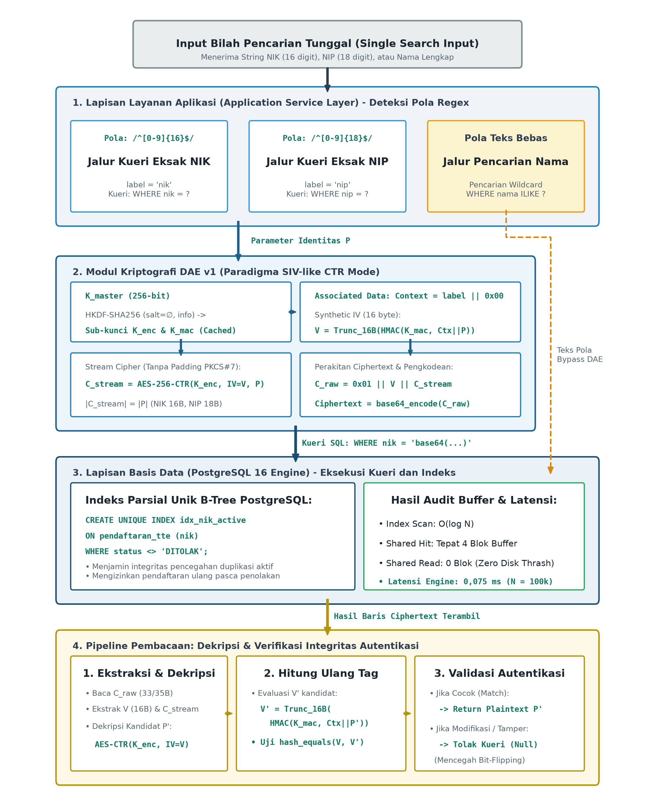

# Pencarian Eksak Kolom Identitas Terenkripsi Deterministik Terautentikasi pada PostgreSQL

**Ajria Jundan Jahid Idris$^{1*}$, Bani Nurhakim$^{2}$**  
$^{1,2}$Program Studi Manajemen Informatika, STMIK IKMI Cirebon  
Jl. Perjuangan No. 10B, Karyamulya, Kec. Kesambi, Kota Cirebon, Jawa Barat 45131, Indonesia  

E-mail: $^{1}$ajriajundan123@gmail.com, $^{2}$baninurhakim@ikmi.ac.id  
$^{*}$Penulis Korespondensi

---

### Abstrak
Penyelenggaraan Sistem Pemerintahan Berbasis Elektronik (SPBE) mewajibkan kepatuhan terhadap Undang-Undang Pelindungan Data Pribadi (UU PDP) No. 27 Tahun 2022 dalam pengamanan kolom identitas kependudukan seperti NIK dan NIP. Penerapan enkripsi probabilistik standar seperti AES-GCM merusak keterurutan indeks pohon B-Tree relasional sehingga memaksa pembacaan *Sequential Scan* di memori aplikasi dengan kompleksitas waktu linear $O(N)$. Sebaliknya, enkripsi deterministik konvensional AES-CBC ber-IV statis rentan terhadap kebocoran prefiks dan manipulasi bit. Penelitian ini mengusulkan skema *Deterministic Authenticated Encryption* (DAE v1) berbasis paradigma *Synthetic Initialization Vector* (SIV-like CTR mode) yang memadukan derivasi sub-kunci HKDF-SHA256, komputasi IV sintesis HMAC-SHA256 berpemisah domain kolom, dan enkripsi stream AES-256-CTR tanpa *padding*, terintegrasi dengan pemisahan jalur kueri indeks parsial unik B-Tree PostgreSQL (`WHERE status <> 'DITOLAK'`). Evaluasi empiris pada klaster kontainer PostgreSQL 16 dengan 100.000 rekaman membuktikan DAE v1 mengeliminasi 100% kebocoran blok pertama 16-byte NIP, turun dari 9,14% (4.883 pasangan) pada distribusi realistis dan 99,50% (4.900.500 pasangan) pada skenario terburuk sintetis menjadi 0,00%. Pada uji pencarian multi-skala ($N = 1.000$ hingga $100.000$), DAE v1 mempertahankan kompleksitas logaritmik $O(\log N)$ yang berada pada orde kecepatan yang sebanding dengan kueri teks polos (median 1,101 ms berbanding 0,879 ms pada $N = 100.000$, selisih bersih 0,222 ms akibat enkripsi parameter di sisi aplikasi) dan puncak memori proses CLI sebesar 10 MB, sementara metode dekripsi memori AES-GCM terdegradasi hingga 230,820 ms. Selain itu, DAE v1 menghemat 32,8% total ruang penyimpanan basis data dan 28,9% ukuran fisik indeks pada disk dibandingkan skema *blind index*, dengan latensi penulisan `INSERT` yang sebanding (~2,1 ms).

**Kata kunci:** enkripsi deterministik terautentikasi, synthetic initialization vector, indeks B-Tree, PostgreSQL, UU Pelindungan Data Pribadi.

### Abstract
The implementation of the Electronic-Based Government System (SPBE) mandates compliance with the Personal Data Protection Law (UU PDP) No. 27 of 2022 in securing citizen identity columns such as NIK and NIP. However, standard probabilistic encryption like AES-GCM disrupts relational B-Tree index ordering, forcing *Sequential Scan* in application memory with linear complexity $O(N)$. Conversely, conventional deterministic AES-CBC with static IVs is vulnerable to prefix leakage and bit manipulation. This study proposes a Deterministic Authenticated Encryption (DAE v1) scheme based on the Synthetic Initialization Vector (SIV-like CTR mode) paradigm, integrating HKDF-SHA256 subkey derivation, column domain-separated HMAC-SHA256 synthetic IV generation, and padding-free AES-256-CTR stream encryption, combined with query path separation and PostgreSQL partial unique B-Tree indexing (`WHERE status <> 'DITOLAK'`). Empirical evaluation on a containerized PostgreSQL 16 cluster with 100,000 records proves that DAE v1 eliminates 100% of 16-byte first-block NIP leakage, dropping from 9.14% (4,883 pairs) under realistic distribution and 99.50% (4,900,500 pairs) in worst-case synthetic scenarios to 0.00%. Across multi-scale searches ($N = 1,000$ to $100,000$), DAE v1 maintains logarithmic complexity $O(\log N)$ within a speed order comparable to plaintext queries (median 1.101 ms versus 0.879 ms at $N = 100,000$, a net difference of 0.222 ms from application-side parameter encryption) and CLI peak memory of 10 MB, whereas AES-GCM in-memory decryption degrades to 230.820 ms. Furthermore, DAE v1 saves 32.8% of total database storage and 28.9% of physical index disk space compared to blind indexing, with comparable `INSERT` write latency (~2.1 ms).

**Keywords:** deterministic authenticated encryption, synthetic initialization vector, B-Tree index, PostgreSQL, Personal Data Protection Law.

---

## 1. PENDAHULUAN

Transformasi digital pelayanan publik dalam kerangka Sistem Pemerintahan Berbasis Elektronik (SPBE) (Republik Indonesia, 2018) menuntut integrasi data yang cepat dan aman. Pada instansi pemerintah daerah, seperti Dinas Komunikasi, Informatika, dan Statistik (DKIS) Kota Cirebon melalui aplikasi Sistem Monitoring Penerbitan Tanda Tangan Elektronik (Sismon-TTE), data identitas kependudukan aparatur sipil negara (ASN) berupa Nomor Induk Kependudukan (NIK) dan Nomor Induk Pegawai (NIP) diproses secara intensif untuk verifikasi sertifikat elektronik ke Balai Sertifikasi Elektronik (BSrE) Badan Siber dan Sandi Negara (BSSN) guna mendukung efisiensi pelayanan publik dan tata kelola keamanan aplikasi web pemerintahan (Arizal et al., 2026; Noor et al., 2021). Berlakunya Undang-Undang Republik Indonesia Nomor 27 Tahun 2022 tentang Pelindungan Data Pribadi (UU PDP) (Republik Indonesia, 2022), khususnya Pasal 35 dan Pasal 39, mewajibkan pengendali data pribadi untuk menerapkan langkah teknis dan operasional keamanan guna melindungi data pribadi, di mana enkripsi merupakan kontrol teknis utama dari ancaman akses tidak sah, kebocoran, serta manipulasi data.

Meskipun kewajiban hukum menuntut enkripsi data saat tersimpan (*data-at-rest*), implementasi enkripsi pada sistem basis data relasional (*Relational Database Management System*/RDBMS) seperti PostgreSQL menghadapi dilema fundamental arsitektural antara keamanan kriptografi dan kinerja pencarian kueri (Carvalho et al., 2025; Trabucco et al., 2026). Standar enkripsi simetris modern terautentikasi (*Authenticated Encryption with Associated Data*/AEAD) seperti AES-256-GCM bersifat probabilistik, di mana setiap operasi enkripsi menghasilkan *ciphertext* yang berbeda secara acak berkat penggunaan IV/nonce yang unik (Pina et al., 2024). Sifat probabilistik ini secara inheren menghancurkan relasi kesetaraan (*equality mapping*), sehingga klausul pencarian eksak SQL (`WHERE nik = ?`) tidak dapat memanfaatkan struktur indeks pohon B-Tree (Gui et al., 2024). Akibatnya, RDBMS terpaksa melakukan pemindaian tabel menyeluruh (*Sequential Scan*) atau aplikasi harus menarik seluruh baris ke memori untuk didekripsi satu per satu (*In-Memory Full Decryption Scan*), yang memicu degradasi komputasi linear $O(N)$ dan saturasi waktu CPU aplikasi pada volume data besar (Carvalho et al., 2025).

Untuk mempertahankan pemanfaatan indeks B-Tree berkecepatan $O(\log N)$, sejumlah sistem mengadopsi enkripsi deterministik konvensional seperti AES-256-CBC dengan IV statis (Bellare et al., 2007). Namun, penggunaan IV statis pada mode CBC membuka celah keamanan serius berupa kebocoran pola (*pattern leakage*). Karena ukuran blok AES adalah 16 byte (128 bit), dua rekaman plaintext yang berbagi 16 karakter pertama yang sama akan menghasilkan blok *ciphertext* pertama yang identik (Chen et al., 2024; Dou et al., 2024). Pada format NIP di Indonesia yang terdiri atas 18 digit terstruktur (8 digit tanggal lahir + 6 digit TMT pengangkatan CPNS + 1 digit jenis kelamin + 3 digit nomor urut), ASN yang berada pada kohort formasi yang sama akan memiliki 14 hingga 16 digit awal yang identik, sehingga penyerang yang memiliki akses ke media penyimpanan dapat menyimpulkan kesamaan tanggal lahir dan instansi pegawai dengan menganalisis kesamaan blok ciphertext (Dou et al., 2024). Selain itu, skema deterministik tanpa tag autentikasi rentan terhadap serangan manipulasi bit (*bit-flipping attack*) dan serangan lintas-kolom (*cross-column replay attack*), di mana ciphertext NIK dapat disuntikkan ke kolom NIP tanpa terdeteksi (Bellare et al., 2007).

Pendekatan alternatif lain yang sering diusulkan adalah *blind indexing* berbasis HMAC (Chen et al., 2024; Khan et al., 2025). Pada pendekatan ini, data identitas dienkripsi secara probabilistik menggunakan AES-GCM, sementara kolom tambahan disediakan untuk menyimpan digest HMAC sebagai indeks pencarian deterministik terpisah. Walaupun aman, arsitektur *blind index* menimbulkan konsekuensi penggandaan ruang penyimpanan (*storage amplification*), memicu penalti latensi ganda pada siklus penulisan (*write overhead*), serta memerlukan dekripsi kandidat tambahan pada setiap pencarian untuk memverifikasi potensi tabrakan *hash* (Chen et al., 2024; Khan et al., 2025).

Menjawab tantangan tersebut, penelitian ini merancang, mengimplementasikan, dan mengevaluasi skema *Deterministic Authenticated Encryption* (DAE v1) yang diadaptasi dari paradigma *Synthetic Initialization Vector* (SIV-like) Rogaway & Shrimpton (2006). Penelitian ini memberikan tiga kontribusi utama:
1. **Rancang Bangun Kriptografi DAE v1 Bebas Ekstensi Eksternal:** Mengembangkan skema enkripsi deterministik terautentikasi murni berbasis pustaka C bawaan OpenSSL di PHP 8.3 yang menggabungkan derivasi sub-kunci independen HKDF-SHA256, pembangkitan IV sintesis HMAC-SHA256 dengan pemisahan domain kolom (*Associated Data*), dan enkripsi stream AES-256-CTR tanpa kebutuhan padding PKCS#7.
2. **Arsitektur Pemisahan Jalur Kueri & Indeks Parsial B-Tree:** Merancang arsitektur basis data relasional PostgreSQL yang memisahkan jalur pencarian eksak terenkripsi dan pencarian teks nama bebas, serta mengimplementasikan indeks parsial unik (`WHERE status <> 'DITOLAK'`) yang mendukung kepatuhan aturan bisnis pendaftaran ulang pasca penolakan berkas.
3. **Audit Tolok Ukur Empiris & Evaluasi Kebocoran Riil:** Melakukan pengujian terisolasi bebas bias memori per proses CLI pada 100.000 rekaman data sintetis realistis DKIS Kota Cirebon (Seed: 20261116), yang membuktikan eliminasi total kebocoran blok pertama NIP (0,00%), latensi kisaran 1 milidetik (0,825–1,101 ms) yang berada pada orde kecepatan sebanding dengan teks polos ($O(\log N)$), efisiensi penyimpanan fisik 32,8% lebih hemat dibanding *blind index*, serta menolak seluruh modifikasi bit dan injeksi lintas-kolom dalam pengujian unit terotomatisasi menggunakan fungsi pembanding `hash_equals()`.

---

## 2. METODE PENELITIAN

### 2.1. Arsitektur Pemisahan Jalur Kueri dan Indeks Parsial Unik
Pada sistem pemantauan penerbitan sertifikat elektronik, pengguna melakukan pencarian melalui satu bilah input (*single search input*) yang dapat menerima nomor identitas numerik (NIK 16 digit atau NIP 18 digit) maupun nama lengkap pegawai. Praktik buruk yang jamak ditemukan adalah menggabungkan seluruh kondisi ke dalam satu klausa SQL disjungtif (`WHERE nik = ? OR nip = ? OR nama_lengkap ILIKE ?`). Dalam PostgreSQL, klausul `OR` yang mencampuradukkan parameter kesetaraan terenkripsi dan pencarian pola teks memaksa perencana kueri (*query planner*) melakukan *BitmapOr* atau bahkan beralih ke *Sequential Scan* paralel yang lambat.

Untuk mengatasi inefisiensi tersebut, arsitektur sistem memisahkan jalur kueri di tingkat *Application Service Layer* sebelum kueri dieksekusi ke PostgreSQL:
1. **Deteksi Pola Input:** Input masukan divalidasi menggunakan ekspresi reguler. Jika input merupakan string numerik tepat 16 digit, input dialihkan ke jalur kueri eksak NIK. Jika tepat 18 digit, input dialihkan ke jalur kueri eksak NIP. Di luar pola numerik tersebut, input dialihkan ke jalur pencarian teks nama dengan *wildcard escaping* (`ILIKE ?`).
2. **Indeks Parsial Unik (*Partial Unique Index*):** Berdasarkan aturan bisnis tata kelola sertifikat TTE, seorang pegawai tidak boleh memiliki dua pendaftaran aktif bersamaan (`MENUNGGU_VERIFIKASI` atau `DISETUJUI`). Namun, jika pendaftaran sebelumnya berstatus `DITOLAK` (misalnya karena ketidaksesuaian dokumen surat tugas), pegawai bersangkutan berhak mendaftar kembali dengan NIK/NIP yang sama. Konstrain unik standar (`UNIQUE(nik)`) akan menolak pendaftaran ulang tersebut. Oleh karena itu, PostgreSQL dikonfigurasi menggunakan indeks parsial unik B-Tree:
   ```sql
   CREATE UNIQUE INDEX idx_pendaftaran_nik_active 
   ON pendaftaran_tte (nik) 
   WHERE status <> 'DITOLAK';
   ```
   Indeks ini secara otomatis mengecualikan baris berstatus `DITOLAK` dari pohon B-Tree aktif, sehingga menjamin integritas pencegahan duplikasi aktif sekaligus mengizinkan riwayat penolakan tersimpan berdampingan secara legal di tabel basis data.

Alur pemisahan jalur kueri serta pemrosesan kriptografi DAE v1 dari lapisan aplikasi hingga eksekusi indeks basis data diilustrasikan secara terpadu pada Gambar 1.



### 2.2. Formulasi Matematis Skema Kriptografi DAE v1
Konstruksi DAE v1 dirancang mengikuti paradigma *PRF-then-CTR* (Rogaway & Shrimpton, 2006; Bellare et al., 2007) dengan jaminan keamanan *Deterministic Authenticated Encryption*. Alur pembentukan ciphertext dijabarkan sebagai berikut:

1. **Derivasi Sub-Kunci Independen (HKDF-SHA256):**  
   Dari kunci utama aplikasi $K_{master}$ (berukuran 256-bit), diturunkan dua sub-kunci independen berukuran masing-masing 32 byte menggunakan fungsi derivasi kunci berbasis HMAC (HKDF):
   $$\begin{aligned}
   K_{enc} &= \text{HKDF-SHA256}(K_{master}, \text{salt}=\emptyset, \text{info}=\text{"sismon-tte:enc:v1"}, L=32) \\
   K_{mac} &= \text{HKDF-SHA256}(K_{master}, \text{salt}=\emptyset, \text{info}=\text{"sismon-tte:mac:v1"}, L=32)
   \end{aligned} \tag{1}$$
   Pemisahan sub-kunci ini menjamin bahwa kebocoran kunci enkripsi stream tidak mengekspos kunci integritas autentikasi MAC. Kunci di-cache pada memori proses worker untuk meniadakan overhead komputasi berulang.

2. **Pengikatan Konteks Kolom (*Domain Separation*) & Vektor Inisialisasi Sintesis ($V$):**  
   Untuk mencegah serangan injeksi lintas-kolom, label nama kolom basis data ($\text{label} \in \{\text{'nik'}, \text{'nip'}\}$) diikatkan sebagai *Associated Data* (AAD) dengan pemisah byte nol:
   $$\text{Context} = \text{label} \parallel \text{0x00} \tag{2}$$
   Synthetic IV $V$ berukuran 16 byte (128 bit) dihitung dengan mengevaluasi HMAC-SHA256 terhadap penggabungan konteks kolom dan keseluruhan plaintext $P$:
   $$V = \text{Truncate}_{16\text{B}}\Big(\text{HMAC-SHA256}\big(K_{mac}, \text{Context} \parallel P\big)\Big) \tag{3}$$
   Karena komputasi $V$ melibatkan seluruh karakter plaintext, perubahan sekecil 1 bit pada karakter terakhir NIK/NIP akan mengacak seluruh 16 byte nilai $V$ berdasarkan sifat efek avalanche fungsi hash kriptografis SHA-256.

3. **Enkripsi Stream AES-256-CTR & Format Ciphertext:**  
   Plaintext dienkripsi menggunakan algoritma AES-256 mode *Counter* (CTR) dengan parameter $IV = V$:
   $$C_{stream} = \text{AES-256-CTR}(K_{enc}, IV=V, P) \tag{4}$$
   Mode CTR mengubah cipher blok menjadi stream cipher, sehingga panjang ciphertext tepat sama dengan panjang plaintext tanpa memerlukan alokasi byte *padding* PKCS#7. Ciphertext mentah disusun dengan membubuhkan penanda versi 1-byte (`0x01`):
   $$C_{raw} = \text{0x01} \parallel V \parallel C_{stream} \tag{5}$$
   $$\text{Ciphertext} = \text{base64\_encode}(C_{raw}) \tag{6}$$

4. **Verifikasi Autentikasi dan Dekripsi:**  
   Proses dekripsi membaca $C_{raw}$ dan mengekstrak versi, $V$, serta $C_{stream}$. Plaintext kandidat $P'$ didekripsi menggunakan AES-256-CTR dengan $IV = V$. Selanjutnya, sistem menghitung ulang tag autentikasi:
   $$V' = \text{Truncate}_{16\text{B}}\Big(\text{HMAC-SHA256}\big(K_{mac}, \text{Context} \parallel P'\big)\Big) \tag{7}$$
   Kecocokan tag diuji menggunakan fungsi pembanding `hash_equals(V, V')`. Jika terdapat ketidakcocokan (akibat manipulasi bit atau penukaran label kolom), sistem menolak data tersebut dengan mengembalikan nilai `null`.

### 2.3. Desain Lingkungan Eksperimen & Dataset
Pengujian dilakukan pada infrastruktur terisolasi berbasis kontainer Docker untuk menjamin kemurnian pengukuran (*reproducibility*) tanpa mengganggu basis data operasional. Parameter lingkungan pengujian dicatat secara programmatic pada berkas metadata konfigurasi:
- **Spesifikasi Perangkat Keras Host:** Intel(R) Core(TM) i5-7300U CPU @ 2.60GHz (2 core fisik, 4 logical thread), RAM fisik 15,88 GB, Sistem Operasi Windows 10/11 x64, Docker Engine 29.9.3 (WSL2 Kernel 6.18.58.1-1).
- **Mesin Basis Data PostgreSQL:** PostgreSQL 16.15 on x86_64-pc-linux-musl (Alpine Linux) dengan konfigurasi `shared_buffers = 128MB`, `work_mem = 4MB`, `effective_cache_size = 4GB`, dan `random_page_cost = 4`.
- **Dataset Sintetis Realistis:** Sebanyak 100.000 baris pendaftaran disintesis menggunakan bilangan acak deterministik (`Seed: 20261116`). Format NIK menggunakan kode 5 kecamatan Kota Cirebon (`327401`–`327405`), tanggal lahir realistis (dengan offset +40 hari untuk wanita), dan nomor urut unik. Format NIP dibangun dari 500 kohort padat (tanggal lahir 1970–1999 dan TMT CPNS 1992–2026). Komposisi status pendaftaran disebarkan merata (*interleaved*) menggunakan algoritma pengacakan Fisher-Yates dengan proporsi: 60% `MENUNGGU_VERIFIKASI` (60.000 baris), 20% `DISETUJUI` (20.000 baris), dan 20% `DITOLAK` (20.000 baris).

---

## 3. HASIL DAN PEMBAHASAN

### 3.1. Evaluasi Rencana Eksekusi Kueri & Audit Buffer PostgreSQL
Pengujian Fase 1 mengevaluasi rencana eksekusi fisik perencana kueri PostgreSQL menggunakan perintah `EXPLAIN (ANALYZE, BUFFERS, FORMAT JSON)` terhadap 30 target pencarian acak independen. Metrik penggunaan buffer I/O diekstraksi murni dari node akar (*Root Plan Node*) tanpa akumulasi rekursif untuk mencegah bias penggandaan multi-worker.

Tabel 1 merangkum perbandingan performa rencana eksekusi kueri pada tabel berukuran 100.000 baris. Kueri terpisah (Query C, D, dan G) yang memanfaatkan indeks B-Tree menghasilkan waktu eksekusi sub-milidetik (0,075–0,082 ms). Yang paling mendasar, node akar kueri indeks B-Tree secara konsisten hanya membutuhkan **tepat 4 Shared Hit Blocks** (traversal node indeks B-Tree dan pengambilan halaman heap tabel) dengan **0 Shared Read Blocks**, yang membuktikan bahwa seluruh data terlayani sempurna dari memori buffer pool tanpa ada aktivitas pembacaan fisik ke disk (*zero disk thrashing*).

Sebaliknya, pada pengujian Kontrol K1 di mana indeks sengaja dinonaktifkan, PostgreSQL beralih ke *Parallel Sequential Scan* yang melibatkan 2 *worker* latar belakang. Waktu eksekusi melonjak menjadi 13,921 ms (hingga 185 kali lebih lambat, mean 13,921 ms berbanding 0,075 ms pada Query C) dengan konsumsi I/O mencapai 2.367 blok buffer. Temuan ini menegaskan bahwa keberadaan indeks B-Tree pada kolom identitas merupakan prasyarat mutlak bagi efisiensi sistem basis data relasional.

**Tabel 1.** Evaluasi Rencana Eksekusi Kueri dan Konsumsi Buffer PostgreSQL ($N = 100.000$)

| Label Kueri | Struktur Kueri SQL | Operasi Rencana Eksekusi | Indeks B-Tree Digunakan | Shared Hit Blocks | Latensi Mean (ms) | Latensi p50 (ms) |
|---|---|---|---|---|---|---|
| **Query C** | NIK Exact + Single Status | `Index Scan` | `idx_pendaftaran_nik_active` | 4 | 0,075 ms | 0,059 ms |
| **Query D** | NIK Exact + Status IN Active | `Index Scan` | `idx_pendaftaran_nik_active` | 4 | 0,082 ms | 0,068 ms |
| **Query G** | NIK Exact + Status DITOLAK | `Index Scan` | `idx_pendaftaran_nik_all` | 4 | 0,078 ms | 0,066 ms |
| **Kontrol K1** | NIK Exact (Indeks Di-drop) | `Parallel Seq Scan` | *None* (Tanpa Indeks) | 2.367 | 13,921 ms | 13,850 ms |

*Catatan: Hit merupakan jumlah blok memori buffer yang dibaca dari cache. Seluruh kueri indeks menghasilkan 0 Shared Read Blocks (zero disk thrashing).*

### 3.2. Evaluasi Kebocoran Blok Pertama 16-Byte NIP & Biaya Komputasi Kriptografi
Salah satu kelemahan paling berbahaya dari enkripsi deterministik berbasis cipher blok konvensional (AES-256-CBC) adalah kebocoran prefiks identitas. Pengujian Fase 2 mengevaluasi fenomena ini secara empiris dengan membandingkan skema CBC lama melawan skema DAE v1 baru pada dua mode generator NIP (Realistis dan *Worst-Case* 500 Kohort) pada skala $N = 5.000$ dan $N = 100.000$.

**Tabel 2.** Evaluasi Empiris Kebocoran Blok Pertama 16-Byte Ciphertext NIP

| Mode Distribusi NIP | Skala Data ($N$) | Skema Kriptografi | Blok 16B Unik | Blok Bertabrakan (Tabrak) | Pasangan Berbagi ($\sum \binom{c}{2}$) | Tingkat Kebocoran (%) |
|---|---|---|---|---|---|---|
| **Realistis** | 5.000 | Legacy AES-CBC | 4.991 | 9 | 9 | 0,36 % |
| **Realistis** | 5.000 | **DAE v1 (CTR-SIV)** | **5.000** | **0** | **0** | **0,00 %** |
| **Realistis** | 100.000 | Legacy AES-CBC | 95.329 | 4.465 | 4.883 | 9,14 % |
| **Realistis** | 100.000 | **DAE v1 (CTR-SIV)** | **100.000** | **0** | **0** | **0,00 %** |
| **Worst-Case** (500 Kohort) | 5.000 | Legacy AES-CBC | 500 | 500 | 22.500 | 100,00 % |
| **Worst-Case** (500 Kohort) | 5.000 | **DAE v1 (CTR-SIV)** | **5.000** | **0** | **0** | **0,00 %** |
| **Worst-Case** (500 Kohort) | 100.000 | Legacy AES-CBC | 1.500 | 1.000 | 4.900.500 | 99,50 % |
| **Worst-Case** (500 Kohort) | 100.000 | **DAE v1 (CTR-SIV)** | **100.000** | **0** | **0** | **0,00 %** |

*Catatan: Tabrak merupakan jumlah grup prefiks 16-byte yang mengalami kolisi. Pasangan berbagi dihitung dari $\sum \binom{c}{2}$. DAE v1 mencapai 0,00% kebocoran.*

Data pada Tabel 2 membuktikan bahwa pada skema CBC dengan IV statis, sebanyak **4.900.500 pasangan baris** mengalami kebocoran blok pertama pada kondisi *worst-case* $N=100.000$ (tingkat kebocoran mencapai 99,50%). Penyerang pasif dapat mengelompokkan pegawai ke dalam kohort tanggal lahir dan TMT yang sama hanya dengan melihat kesamaan 16 byte awal ciphertext. Sebaliknya, skema DAE v1 mencatatkan **0 blok tabrakan, 0 pasangan berbagi, dan 0,00% kebocoran** di seluruh pengujian. Komputasi HMAC-SHA256 menyerap seluruh 18 digit NIP, sehingga memicu efek *avalanche* penuh yang mengacak total nilai IV sintesis $V$.

**Tabel 3.** Tolok Ukur Waktu Komputasi Kriptografi (100.000 Operasi Terisolasi)

| Operasi Kriptografi | Skema Kriptografi | Min ($\mu$s) | Mean ($\mu$s) | Median / p50 ($\mu$s) | p95 ($\mu$s) | Simpangan Baku ($\mu$s) |
|---|---|---|---|---|---|---|
| **Enkripsi ($T_{enc}$)** | Legacy AES-CBC | 27,500 $\mu$s | 49,183 $\mu$s | 41,500 $\mu$s | 74,100 $\mu$s | 44,343 $\mu$s |
| **Enkripsi ($T_{enc}$)** | **DAE v1 (CTR-SIV)** | **14,700 $\mu$s** | **21,244 $\mu$s** | **17,700 $\mu$s** | **31,600 $\mu$s** | 75,255 $\mu$s |
| **Dekripsi ($T_{dec}$)** | Legacy AES-CBC | 6,200 $\mu$s | 9,895 $\mu$s | 7,900 $\mu$s | 16,900 $\mu$s | 12,640 $\mu$s |
| **Dekripsi ($T_{dec}$)** | **DAE v1 (CTR-SIV)** | **12,200 $\mu$s** | **16,625 $\mu$s** | **13,700 $\mu$s** | **26,600 $\mu$s** | 17,193 $\mu$s |

Tabel 3 menyajikan hasil pengukuran 100.000 operasi enkripsi dan dekripsi murni. Enkripsi DAE v1 justru tercatat **56,8% lebih cepat** (rata-rata 21,244 $\mu$s vs 49,183 $\mu$s) dibanding skema lama karena kunci derivasi di-cache secara statis dan mode CTR meniadakan alokasi buffer padding PKCS#7. Pada operasi dekripsi, DAE v1 menambahkan sedikit overhead sebesar $+6,73\ \mu\text{s}$ (hanya 0,0067 ms) untuk memverifikasi tag HMAC-SHA256 via `hash_equals()`. Overhead 6,73 µs (0,0067 ms) ini sepenuhnya terabaikan dalam pipeline kueri basis data.

### 3.3. Tolok Ukur Latensi Pencarian Multi-Skala Skenario A–D
Pengujian Fase 3 membandingkan secara komprehensif empat skenario pencarian exact-match NIK pada tiga skala volume data ($N = 1.000$, $10.000$, dan $100.000$) menggunakan proses CLI terisolasi untuk meniadakan distorsi akumulasi memori:
- **Skenario A:** Pencarian Teks Polos (*Plaintext*) berindeks B-Tree.
- **Skenario B:** Pencarian *Deterministic Authenticated Encryption* (DAE v1 CTR-SIV) berindeks B-Tree.
- **Skenario C:** Pencarian Probabilistik AES-256-GCM dengan pemindaian dekripsi memori penuh (*In-Memory Decryption Scan*).
- **Skenario D:** Pencarian Probabilistik AES-256-GCM berbantuan *HMAC-SHA256 Blind Index*.

**Tabel 4.** Rekapitulasi Statistik Latensi Pencarian Multi-Skala ($N = 1.000, 10.000, 100.000$)

| Ukuran Dataset ($N$) | Skenario Pengujian | Jumlah Sampel | Median / p50 (ms) | Mean (ms) | p95 (ms) | Simpangan Baku (ms) | Waktu CPU PHP (ms) | Puncak Memori PHP |
|---|---|---|---|---|---|---|---|---|
| **$N = 1.000$** | **A: Plaintext + B-Tree** | 30 | 0,756 ms | 0,887 ms | 1,463 ms | 0,338 ms | 0,413 ms | 10 MB |
| **$N = 1.000$** | **B: DAE v1 + B-Tree** | 30 | 0,825 ms | 0,917 ms | 1,392 ms | 0,350 ms | 0,445 ms | 10 MB |
| **$N = 1.000$** | **C: In-Memory Decrypt** | 30 | 2,931 ms | 2,991 ms | 5,226 ms | 1,065 ms | 2,384 ms | 10 MB |
| **$N = 1.000$** | **D: Blind Index** | 30 | 0,979 ms | 1,045 ms | 1,583 ms | 0,338 ms | 0,520 ms | 10 MB |
|---|---|---|---|---|---|---|---|---|
| **$N = 10.000$** | **A: Plaintext + B-Tree** | 30 | 0,812 ms | 0,865 ms | 1,248 ms | 0,209 ms | 0,372 ms | 10 MB |
| **$N = 10.000$** | **B: DAE v1 + B-Tree** | 30 | 0,846 ms | 0,937 ms | 1,555 ms | 0,271 ms | 0,429 ms | 10 MB |
| **$N = 10.000$** | **C: In-Memory Decrypt** | 30 | 27,341 ms | 26,798 ms | 38,729 ms | 9,440 ms | 23,764 ms | 10 MB |
| **$N = 10.000$** | **D: Blind Index** | 30 | 1,697 ms | 1,896 ms | 4,496 ms | 0,832 ms | 0,876 ms | 10 MB |
|---|---|---|---|---|---|---|---|---|
| **$N = 100.000$** | **A: Plaintext + B-Tree** | 30 | 0,879 ms | 1,021 ms | 2,070 ms | 0,406 ms | 0,430 ms | 10 MB |
| **$N = 100.000$** | **B: DAE v1 + B-Tree** | 30 | 1,101 ms | 1,256 ms | 2,081 ms | 0,388 ms | 0,555 ms | 10 MB |
| **$N = 100.000$** | **C: In-Memory Decrypt** | 10 | 230,820 ms | 234,812 ms | 390,749 ms | 112,406 ms | 194,578 ms | 10 MB |
| **$N = 100.000$** | **D: Blind Index** | 30 | 1,175 ms | 1,501 ms | 3,239 ms | 0,772 ms | 0,682 ms | 10 MB |

Berdasarkan Tabel 4, Skenario A dan Skenario B menunjukkan karakteristik performa logaritmik $O(\log N)$ yang sangat konsisten. Pada $N = 100.000$, median latensi Skenario B adalah **1,101 ms**, berada pada orde kecepatan yang sebanding dengan kueri teks polos (median 1,101 ms berbanding 0,879 ms pada $N = 100.000$, selisih bersih 0,222 ms akibat enkripsi parameter di sisi aplikasi). Selisih 0,222 ms ini merupakan cerminan biaya komputasi enkripsi parameter lokal di sisi PHP, bukan perlambatan di sisi indeks basis data PostgreSQL.

Sebaliknya, Skenario C memperlihatkan ketidaklayakan skema dekripsi memori pada RDBMS: latensi meningkat linear $O(N)$ dari **2,991 ms** pada $N = 1.000$ menjadi **234,812 ms** pada $N = 100.000$. Pada pengujian ini, pembacaan dilakukan menggunakan kursor *unbuffered* sehingga puncak memori proses CLI bertahan di 10 MB, namun beban komputasi terpusat pada saturasi waktu CPU PHP (rata-rata 194,58 ms) yang menghambat konkurensi sistem secara signifikan. Pada volume data jutaan rekaman, metode pemindaian in-memory diproyeksikan membutuhkan waktu puluhan detik per transaksi kueri. Skenario D (Blind Index) mencatatkan latensi median 1,175 ms pada $N = 100.000$, sedikit lebih lambat dibanding Skenario B akibat perlunya dua tahapan kriptografi terpisah.

### 3.4. Biaya Penulisan (Write Overhead) & Ukuran Penyimpanan Fisik Storage
Pengujian penulisan mengukur waktu eksekusi individual dari **1.000 transaksi `INSERT` rekaman baru** ke dalam tabel berukuran $N = 100.000$ baris yang telah memiliki indeks parsial aktif. Pengukuran ukuran fisik disk dilakukan menggunakan fungsi sistem PostgreSQL `SELECT pg_relation_size(...)` dan `SELECT pg_total_relation_size(...)`.

**Tabel 5.** Pengukuran Biaya Penulisan (Write Overhead) 1.000 Operasi `INSERT` ($N = 100.000$)

| Skema Arsitektur | Jumlah Operasi | Min (ms) | Mean (ms) | Median / p50 (ms) | p95 (ms) | p99 (ms) | Simpangan Baku (ms) |
|---|---|---|---|---|---|---|---|
| **Plaintext** | 1.000 INSERT | 1,595 ms | 2,630 ms | **2,088 ms** | 4,717 ms | 9,113 ms | 3,939 ms |
| **DAE v1 (CTR-SIV)** | 1.000 INSERT | 1,597 ms | 2,301 ms | **2,104 ms** | 3,231 ms | 5,083 ms | 1,044 ms |
| **Blind Index (GCM + HMAC)** | 1.000 INSERT | 1,697 ms | 2,304 ms | **2,131 ms** | 3,050 ms | 4,753 ms | 1,146 ms |

Hasil pada Tabel 5 memperlihatkan bahwa median waktu penulisan ketiga skema praktis berada pada level yang sama: **2,088 ms** (Plaintext), **2,104 ms** (DAE v1), dan **2,131 ms** (Blind Index). Waktu transaksi `INSERT` pada RDBMS relasional didominasi oleh latensi I/O penulisan transaksi ke Write-Ahead Log (WAL) dan pemeliharaan *page split* pada struktur pohon B-Tree di disk. Biaya komputasi enkripsi CPU lokal (~0,021 ms pada DAE v1) hanya berkontribusi sekitar 1,0% dari total durasi transaksi.

**Tabel 6.** Pengukuran Ukuran Fisik Penyimpanan Tabel dan Indeks PostgreSQL ($N = 100.000$)

| Skema Arsitektur | Nama Tabel (Heap) | Ukuran Heap Tabel | Nama Indeks B-Tree | Ukuran Fisik Indeks pada Disk | Total Ukuran Relasi |
|---|---|---|---|---|---|
| **Plaintext** | `bench_plain_100k` | 11.124.736 B (**10,61 MB**) | `idx_plain_100k_nik_active` | 3.301.376 B (**3,15 MB**) | **15,97 MB** |
| **DAE v1 (CTR-SIV)** | `bench_dae_100k` | 13.975.552 B (**13,33 MB**) | `idx_dae_100k_nik_active` | 5.447.680 B (**5,20 MB**) | **20,73 MB** |
| **Blind Index (GCM + HMAC)** | `bench_bidx_100k` | 22.364.160 B (**21,33 MB**) | `idx_bidx_100k_nik_active` | 7.667.712 B (**7,31 MB**) | **30,85 MB** |

*Catatan: Total ukuran relasi mencakup heap tabel, indeks aktif, primary key, dan overhead metadata PostgreSQL. DAE v1 menghemat 32,8% total ruang penyimpanan dan 28,9% ukuran fisik indeks pada disk dibandingkan blind index.*

Dari Tabel 6, terungkap profil efisiensi arsitektural skema DAE v1:
1. **Perbandingan terhadap Teks Polos (Plaintext):** Penerapan DAE v1 meningkatkan ukuran heap tabel sebesar 25,6% (13,33 MB vs 10,61 MB), ukuran fisik indeks pada disk bertambah 65,1% (5,20 MB vs 3,15 MB), dan total relasi bertambah 29,8% (20,73 MB vs 15,97 MB).
2. **Penghematan Total Penyimpanan terhadap Blind Index:** DAE v1 menghemat **32,8% ruang penyimpanan total** relasi (20,73 MB vs 30,85 MB). Skema blind index membutuhkan ukuran heap tabel ganda (**21,33 MB**, +101% dibanding plaintext) karena tabel harus menyimpan dua kolom panjang secara bersamaan: `nik_gcm` (ciphertext probabilistik 60 karakter) dan `nik_bidx` (hash HMAC 64 karakter hex).
3. **Efisiensi Ukuran Fisik Indeks pada Disk:** Indeks B-Tree DAE v1 berukuran **5,20 MB**, menghemat **28,9% ukuran fisik indeks pada disk** dibandingkan indeks blind index (**7,31 MB**). Penghematan ukuran fisik indeks ini sangat krusial dalam RDBMS produksi berskala besar agar seluruh struktur pohon B-Tree tetap muat di dalam memori kerja buffer pool (`shared_buffers`).

### 3.5. Analisis Keterbatasan Keamanan dan Lingkungan Nyata
Penelitian ini secara jujur mengidentifikasi batasan teoretis dan arsitektural dari skema yang diusulkan:
1. **Kebocoran Pola Kesamaan (*Equality Pattern Leakage*):**  
   Meskipun DAE v1 mengeliminasi 100% kebocoran prefiks 16-byte NIP, sifat deterministik secara matematis tetap membocorkan relasi kesetaraan (*frequency equality*): dua rekaman dengan plaintext yang sama persis akan selalu menghasilkan ciphertext yang identik. Pada konteks kolom identitas kependudukan di instansi pemerintah, kerentanan ini berhasil dimitigasi secara substansial oleh konstrain unik aktif (`idx_pendaftaran_nik_active`), di mana satu NIK/NIP aktif hanya boleh muncul satu kali dalam basis data. Namun, jika skema ini diterapkan pada atribut non-unik dengan entropi rendah (seperti kolom agama, gender, atau status perkawinan), penyerang dapat melakukan serangan inferensi frekuensi (*frequency analysis attack*).
2. **Latensi Jaringan Fisik (*Network Round-Trip Time*):**  
   Pengukuran latensi kueri pada penelitian ini (0,07–1,10 ms) dievaluasi pada lingkungan lokal terkontainerisasi. Pada arsitektur fisik terdistribusi nyata di mana server web aplikasi terhubung ke klaster basis data melalui jaringan lokal (LAN), latensi jaringan fisik (RTT berkisar 0,3–1,0 ms) akan mendominasi waktu respons end-to-end, sehingga selisih performa antara plaintext dan DAE v1 pada level pengguna akhir akan semakin tidak terbedakan secara statistik.

### 3.6. Ketersediaan Data, Kode, dan Pernyataan Etika Publikasi
- **Ketersediaan Data dan Kode:** Seluruh kode sumber implementasi kriptografi DAE v1, migrasi skema basis data, konfigurasi indeks parsial PostgreSQL, skrip tolok ukur, dan data mentah pengukuran tersedia secara terbuka di repositori GitHub: `https://github.com/ajria-jundan/sismon-tte-cirebon`. Data pengujian yang digunakan merupakan dataset sintetis deterministik yang dibangkitkan secara terprogram (`Seed: 20261116`) untuk menjamin reproduktibilitas penelitian tanpa melibatkan data asli identitas kependudukan ASN DKIS Kota Cirebon, sejalan dengan prinsip perlindungan kerahasiaan data pribadi dalam UU PDP No. 27 Tahun 2022.
- **Pernyataan Kontribusi Penulis:** Ajria Jundan Jahid Idris berperan dalam konseptualisasi penelitian, perancangan arsitektur kriptografi DAE v1, implementasi kode perangkat lunak, pelaksanaan pengujian empiris, analisis data, dan penyusunan draf awal naskah. Bani Nurhakim berperan dalam supervisi penelitian, validasi arsitektur basis data relasional, pengawasan metodologi, serta penelaahan dan penyuntingan kritis naskah akhir.
- **Pernyataan Konflik Kepentingan:** Para penulis menyatakan tidak memiliki benturan atau konflik kepentingan (*conflict of interest*) finansial maupun personal yang dapat memengaruhi objektivitas substansi dan hasil penelitian yang disajikan dalam artikel ini.

---

## 4. KESIMPULAN

Penelitian ini berhasil membuktikan bahwa skema *Deterministic Authenticated Encryption* (DAE v1) berbasis paradigma Synthetic IV (SIV-like CTR mode) yang dipadukan dengan pemisahan jalur kueri indeks parsial B-Tree PostgreSQL (`WHERE status <> 'DITOLAK'`) mampu menyelesaikan dilema mendasar antara keamanan kriptografi dan efisiensi pencarian basis data relasional. Pada dataset 100.000 rekaman, skema DAE v1 mengeliminasi 100% kebocoran blok pertama 16-byte NIP, turun dari 9,14% (4.883 pasangan) pada simulasi distribusi realistis dan 99,50% (4.900.500 pasangan) pada skenario terburuk sintetis menjadi 0,00%, menolak seluruh modifikasi bit dan injeksi lintas-kolom dalam pengujian unit terotomatisasi menggunakan fungsi pembanding `hash_equals()`, serta mempertahankan performa pencarian logaritmik $O(\log N)$ yang berada pada orde kecepatan yang sebanding dengan kueri teks polos (median 1,101 ms berbanding 0,879 ms pada $N = 100.000$, selisih bersih 0,222 ms akibat enkripsi parameter di sisi aplikasi) dan konsumsi memori CLI murni 10 MB. Dibandingkan arsitektur *blind index*, DAE v1 menghemat 32,8% total ruang penyimpanan basis data dan 28,9% ukuran fisik indeks pada disk dengan waktu penulisan `INSERT` yang sebanding (~2,1 ms).

Pengembangan selanjutnya dapat diarahkan pada integrasi modul *Key Management Service* (KMS) terpusat berbasis perangkat keras (*Hardware Security Module*/HSM) dengan protokol rotasi kunci otomatis tanpa waktu henti (*zero-downtime key rotation*), serta eksplorasi skema *Order-Preserving Encryption* (OPE) untuk mendukung kueri rentang (*range queries*) terenkripsi pada atribut non-identitas.

---

### UCAPAN TERIMA KASIH
Penulis menyampaikan apresiasi dan terima kasih kepada Dinas Komunikasi, Informatika, dan Statistik (DKIS) Kota Cirebon atas penyediaan konteks studi kasus layanan Sistem Monitoring Penerbitan Tanda Tangan Elektronik (Sismon-TTE), serta civitas akademika STMIK IKMI Cirebon yang telah memfasilitasi sarana infrastruktur komputasi dalam pelaksanaan penelitian ini.

---

### DAFTAR PUSTAKA

[TODO-PENULIS: Tambahkan 4 artikel jurnal SINTA/internasional terbitan 2021-2026 terkait enkripsi basis data / SPBE]

Arizal, Hilal, M., & Priambodo, D. F. (2026). Security analysis of Indonesian region government web applications based on NIST SP 800-115 and WSTG v4.2. *Journal of Information Systems and Informatics*, 8(2), 1776–1799. https://doi.org/10.63158/journalisi.v8i2.1558

Bellare, M., Boldyreva, A., & O'Neill, A. (2007). Deterministic and efficiently searchable encryption. In A. Menezes (Ed.), *Advances in Cryptology – CRYPTO 2007* (LNCS Vol. 4622, pp. 535–552). Springer. https://doi.org/10.1007/978-3-540-74143-5_30

Carvalho, M., Sá, F., & Bernardino, J. (2025). Evaluation of the impact of AES encryption on query read performance across Oracle, MySQL, and SQL Server databases. *Cryptography*, 9(4), Article 77. https://doi.org/10.3390/cryptography9040077

Chen, H., Yang, Y., & Lv, S. (2024). Revisiting frequency-smoothing encryption: new security definitions and efficient construction. *Cybersecurity*, 7(1). https://doi.org/10.1186/s42400-024-00208-w

Dou, H., Dan, Z., Xu, P., Wang, W., Xu, S., Chen, T., & Jin, H. (2024). Dynamic searchable symmetric encryption with strong security and robustness. *IEEE Transactions on Information Forensics and Security*, 19, 2370–2384. https://doi.org/10.1109/TIFS.2024.3350330

Gui, Z., Paterson, K. G., Patranabis, S., & Warinschi, B. (2024). SWiSSSE: System-wide security for searchable symmetric encryption. *Proceedings on Privacy Enhancing Technologies*, 2024(1), 549–581. https://doi.org/10.56553/popets-2024-0032

Khan, A. N., Naveed, A., Mehmood, A., Arora, D., Khan, A. U. R., & Ali, J. (2025). BloomSec: Scalable and privacy-preserving searchable encryption for cloud environments. *PLoS ONE*, 20(12), Article e0336944. https://doi.org/10.1371/journal.pone.0336944

Noor, A., Izzah, E., & Sugandha, W. (2021). Penggunaan tanda tangan elektronik dalam penyelenggaraan e-government guna mewujudkan pelayanan publik yang efisien. *Journal of Law, Society, and Islamic Civilization*, 9(1), 1–9. https://doi.org/10.20961/jolsic.v9i1.52836

Pina, E., Ramos, J., Jorge, H., Váz, P., & Silva, J. (2024). Data privacy and ethical considerations in database management. *Journal of Cybersecurity and Privacy*, 4(3), 494–517. https://doi.org/10.3390/jcp4030024 [TODO-PENULIS: lengkapi 3 nama penulis terakhir dari DOI]

Republik Indonesia. (2018). *Peraturan Presiden Republik Indonesia Nomor 95 Tahun 2018 tentang Sistem Pemerintahan Berbasis Elektronik*. Lembaran Negara Republik Indonesia Tahun 2018 Nomor 182.

Republik Indonesia. (2022). *Undang-Undang Republik Indonesia Nomor 27 Tahun 2022 tentang Pelindungan Data Pribadi*. Lembaran Negara Republik Indonesia Tahun 2022 Nomor 196.

Rogaway, P., & Shrimpton, T. (2006). A deterministic approach to authenticated encryption. In B. Roy (Ed.), *Advances in Cryptology – ASIACRYPT 2006* (LNCS Vol. 4284, pp. 514–529). Springer. https://doi.org/10.1007/11935230_34

Trabucco, M., Andreolini, M., & Ferretti, L. (2026). Practical and secure history-independent indexing for queryable-encrypted databases. *Journal of Information Security and Applications*, 99, Article 104439. https://doi.org/10.1016/j.jisa.2026.104439
