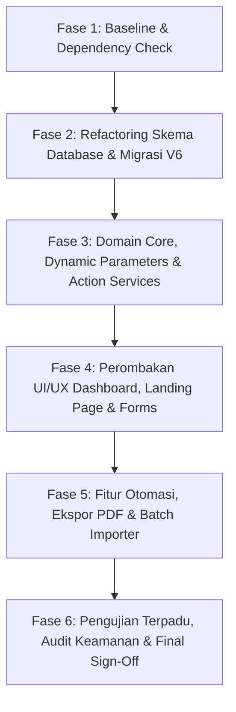

# DOKUMEN RENCANA IMPLEMENTASI (IMPLEMENTATION PLAN)
## Sistem Informasi Manajemen & Validasi Tanda Tangan Elektronik (SISMON TTE) - Versi 6.0 (V6)
**Instansi:** Dinas Komunikasi dan Informatika (DKIS) Kota Cirebon  
**Versi Dokumen:** 1.0 (Konsolidasi Arahan Pimpinan & Lintas Bidang)  
**Status Dokumen:** Baseline Teknis & Rencana Aksi Eksekusi V6  
**Direktori Target:** `D:\Dockerr\sismon-tte-V6`  
**Tanggal Penyusunan:** Oktober 2026  

---

## 1. PENDAHULUAN & RINGKASAN EKSEKUTIF

Dokumen ini merupakan panduan teknis dan rencana implementasi arsitektur perangkat lunak untuk pembaruan **Sistem Monitoring dan Validasi Tanda Tangan Elektronik (SISMON TTE) Versi 6 (V6)**. Pengembangan versi ini didasarkan pada Software Requirements Specification (SRS) hasil konsolidasi arahan pimpinan (Kepala Dinas) dan kebutuhan teknis operasional lintas bidang di lingkungan DKIS Kota Cirebon.

Pembaruan V6 ini mentransformasikan sistem dari pengelolaan pendaftaran TTE ASN internal menjadi platform terpadu berskala kota yang mencakup:
1. **Inklusivitas Pegawai:** Perluasan layanan bagi pegawai Non-ASN dengan alur formulir yang fleksibel dan adil.
2. **Standardisasi Data Nasional & Daerah:** Penggunaan Primary Key kode referensi resmi pemerintah (non-generated auto-increment) pada master SKPD dan Jabatan/Golongan.
3. **Anti Hard-Coding:** Tata kelola kebijakan dinamis melalui tabel parameter sistem yang dapat dikonfigurasi melalui panel admin tanpa menyentuh kode sumber.
4. **Efisiensi Operasional Superadmin:** Mekanisme validasi masal (bulk validation), pencarian dinamis cerdas, pengurutan multi-kriteria, dan mitigasi kesalahan operasional dengan konfirmasi ganda dan fitur pembatalan (Undo, termasuk Undo Revoke).
5. **Transparansi & Pimpinan Publik:** Redesain landing page dengan metrik ketercapaian agregat SKPD secara transparan, fitur permohonan kunjungan layanan on-site, redefinisi metrik "Capaian Kota" (Macro & Micro view), serta modul pencetakan laporan resmi berformat PDF.

---

## 2. MATRIKS ANALISIS GAP & SPESIFIKASI KEBUTUHAN SRS

| No | Modul / Area | Status Eksisting (V5) | Spesifikasi Kebutuhan Baru (V6) | Prioritas |
|---|---|---|---|---|
| 1 | **Aksesibilitas & Registrasi** | Hanya untuk ASN, NIP wajib 18 digit, username email harus kombinasi teks. | Jalur pendaftaran dipisah (ASN & Non-ASN), NIP opsional untuk Non-ASN, format email dinas angka penuh (misal NIP@cirebonkota.go.id), dan fitur Account Recovery via NIK/NIP. | **Tinggi** |
| 2 | **Arsitektur Database** | PK tabel master menggunakan `id` auto-increment (`bigint`), masa berlaku hardcoded 2 tahun. | PK Master SKPD & Jabatan/Golongan menggunakan Kode Referensi Resmi Daerah, masa berlaku sertifikat dikelola via tabel parameter dinamis, penyediaan modul impor data historis (CSV/Excel). | **Tinggi** |
| 3 | **Antarmuka (UI/UX) & Dashboard** | Antrian verifikasi panjang di dashboard, label tombol "Terbitkan Sertifikat TTE". | Redesain dashboard ringkas (5-10 pengajuan terbaru + shortcut ke antrian), widget preview sertifikat mendekati kadaluarsa, tombol aksi diubah menjadi "Validasi Sertifikat TTE". | **Sedang** |
| 4 | **Layanan Portal Publik** | Halaman depan langsung form pendaftaran single-step. | Landing page pimpinan transparan (Data Agregat Capaian SKPD), tombol navigasi pendaftaran, formulir "Pengajuan Kunjungan Layanan TTE". | **Tinggi** |
| 5 | **Alur Verifikasi Masal** | Verifikasi satu per satu (single-item), filter sederhana. | Verifikasi Masal (bulk check & submit), pencarian dinamis (toleran spasi & per digit NIK/NIP), sorting SKPD & Waktu (Asc/Desc), validasi lampiran dokumen bukti TTE eksisting pada Tahap 2. | **Tinggi** |
| 6 | **Mitigasi Kesalahan & Keamanan** | Aksi langsung dieksekusi dengan konfirmasi browser standar, tidak ada fungsi undo. | Modal konfirmasi ganda (*double-check*) interaktif, mekanisme Undo aksi administratif, fitur *Undo Revoke* untuk memulihkan sertifikat terlanjur dicabut kembali ke status AKTIF. | **Tinggi** |
| 7 | **Pelaporan & Notifikasi** | Metrik "Rata-rata Capaian", ekspor hanya CSV, notifikasi kadaluarsa belum terjadwal otomatis. | Redefinisi metrik "Capaian Kota" (Macro Tingkat Kota & Micro Tingkat SKPD), manajemen target SKPD bulanan, scheduler otomatis email H-7, ekspor laporan PDF resmi terfilter SKPD & tanggal. | **Tinggi** |

---

## 3. RANCANGAN ARSITEKTUR TEKNIS & SKEMA DATABASE

### 3.1 Skema Database & Migrasi Baru

#### A. Penyesuaian Tabel `pendaftaran_tte`
- Menambahkan kolom `tipe_pegawai` (`VARCHAR(20)`: `'ASN'`, `'NON_ASN'`). Default: `'ASN'`.
- Mengubah kolom `nip` menjadi `nullable` untuk mengakomodasi pendaftar Non-ASN.
- Menambahkan kolom `file_bukti_tte` (`VARCHAR(255)`, nullable) untuk menyimpan path berkas bukti kepemilikan TTE aktif sebelumnya.
- Memperbarui relasi dan partial unique index:
  * NIK tetap wajib 16 digit dan unik deterministik untuk status `!= 'DITOLAK'`.
  * NIP hanya dicek keunikannya jika terisi (non-null).

#### B. Refactoring Master Data dengan Official Reference Code (Non-Generated PK)
- **Tabel `master_skpd`**:
  * Menggunakan `kode_skpd` resmi (contoh: `1.01.01...`) sebagai Primary Key (`VARCHAR(50)`).
  * Menyelaraskan foreign key `skpd_id` (atau `kode_skpd`) pada transaksi dengan strategi migrasi data tanpa merusak integritas referensial.
- **Tabel `master_jabatan` dan `master_golongan`**:
  * Normalisasi pemisahan atau restrukturisasi tabel dengan PK menggunakan kode resmi BKN / Pemerintah Daerah (contoh: `JAB-xxx`, `GOL-IV-A`).

#### C. Tabel Konfigurasi Parameter Kebijakan Dinamis (`system_parameters`)
```sql
CREATE TABLE system_parameters (
    id BIGSERIAL PRIMARY KEY,
    param_key VARCHAR(100) UNIQUE NOT NULL,
    param_value TEXT NOT NULL,
    param_group VARCHAR(50) NOT NULL DEFAULT 'GENERAL',
    data_type VARCHAR(20) NOT NULL DEFAULT 'STRING', -- STRING, INTEGER, BOOLEAN, JSON
    label VARCHAR(255) NOT NULL,
    description TEXT NULL,
    created_at TIMESTAMPTZ DEFAULT CURRENT_TIMESTAMP,
    updated_at TIMESTAMPTZ DEFAULT CURRENT_TIMESTAMP
);
```
*Parameter awal:*
- `cert_validity_years` (Default: `2`)
- `cert_expiry_warning_days` (Default: `7`)
- `allow_non_asn_registration` (Default: `true`)
- `bulk_verification_max_batch` (Default: `50`)
- `city_adoption_target_percent` (Default: `100`)

#### D. Tabel Pengelolaan Target SKPD Bulanan (`skpd_target_metrics`)
```sql
CREATE TABLE skpd_target_metrics (
    id BIGSERIAL PRIMARY KEY,
    skpd_id VARCHAR(50) NOT NULL,
    tahun INT NOT NULL,
    bulan INT NOT NULL,
    target_persentase NUMERIC(5,2) DEFAULT 100.00,
    target_jumlah_pegawai INT DEFAULT 0,
    created_at TIMESTAMPTZ DEFAULT CURRENT_TIMESTAMP,
    updated_at TIMESTAMPTZ DEFAULT CURRENT_TIMESTAMP,
    UNIQUE(skpd_id, tahun, bulan)
);
```

#### E. Tabel Pengajuan Kunjungan Layanan TTE (`pengajuan_kunjungan_layanan`)
```sql
CREATE TABLE pengajuan_kunjungan_layanan (
    id BIGSERIAL PRIMARY KEY,
    nomor_tiket VARCHAR(64) UNIQUE NOT NULL,
    skpd_id VARCHAR(50) NOT NULL,
    nama_pemohon VARCHAR(255) NOT NULL,
    jabatan_pemohon VARCHAR(255) NOT NULL,
    kontak_pemohon VARCHAR(30) NOT NULL,
    tanggal_usulan_kunjungan DATE NOT NULL,
    perkiraan_peserta INT NOT NULL DEFAULT 1,
    catatan_kebutuhan TEXT NOT NULL,
    file_surat_permohonan VARCHAR(255) NULL,
    status VARCHAR(30) DEFAULT 'MENUNGGU_VERIFIKASI', -- MENUNGGU_VERIFIKASI, DIJADWALKAN, SELESAI, DITOLAK
    catatan_petugas TEXT NULL,
    tanggal_kunjungan_final DATE NULL,
    created_at TIMESTAMPTZ DEFAULT CURRENT_TIMESTAMP,
    updated_at TIMESTAMPTZ DEFAULT CURRENT_TIMESTAMP
);
```

#### F. Tabel Log Riwayat Aksi & Undo (`audit_action_history`)
```sql
CREATE TABLE audit_action_history (
    id BIGSERIAL PRIMARY KEY,
    action_type VARCHAR(50) NOT NULL, -- VERIFIKASI_TAHAP1, PENERBITAN_TAHAP2, TOLAK_PENDAFTARAN, REVOKE_SERTIFIKAT
    entity_type VARCHAR(100) NOT NULL, -- PendaftaranTte, SertifikatTte
    entity_id VARCHAR(64) NOT NULL,
    user_id BIGINT NOT NULL,
    previous_state JSONB NOT NULL,
    new_state JSONB NOT NULL,
    is_undone BOOLEAN DEFAULT FALSE,
    undone_by BIGINT NULL,
    undone_at TIMESTAMPTZ NULL,
    created_at TIMESTAMPTZ DEFAULT CURRENT_TIMESTAMP
);
```

---

## 4. SPESIFIKASI FITUR DAN DETAIL IMPLEMENTASI TEKNIS

### 4.1 Modul 1: Aksesibilitas, Registrasi ASN & Non-ASN, dan Pemulihan Akun
1. **Formulir Dual-Track (Jalur ASN & Non-ASN):**
   - Komponen switch/tab interaktif pada halaman pendaftaran:
     * *Jalur ASN:* NIK 16 digit, NIP 18 digit wajib, SKPD Kota Cirebon, Jabatan & Golongan resmi.
     * *Jalur Non-ASN:* NIK 16 digit wajib, NIP bersifat opsional, Unit Kerja resmi Kota Cirebon, Jabatan/Tugas Kerja deskriptif, dan verifikasi keaktifan unit kerja.
2. **Format Email Usulan Angka Penuh:**
   - Memodifikasi `StorePendaftaranAction` dan validator email agar menerima format username angka murni (contoh: NIP atau digit identitas seperti `199012312015011001@cirebonkota.go.id`).
3. **Workflow Pemulihan Akses & Kredensial (Account Recovery):**
   - Rute publik `/recovery`:
     * Langkah 1: Input NIK dan/atau NIP terdaftar beserta nomor kontak.
     * Langkah 2: Sistem memvalidasi keberadaan data pendaftaran dan status sertifikat TTE aktif.
     * Langkah 3: Menampilkan informasi status kepemilikan sertifikat/email dinas dan memfasilitasi permohonan pemulihan kredensial atau panduan aktivasi ulang secara aman.

### 4.2 Modul 2: Arsitektur Parameter Dinamis & Impor Data Historis
1. **System Parameter Engine:**
   - Service class `App\Services\SystemParameterService` dengan integrasi Redis Cache untuk membaca konfigurasi tanpa beban query berulang.
   - Perhitungan masa kedaluwarsa sertifikat: `now()->addDays(SystemParameterService::get('cert_validity_days', 730))` menggantikan kode hardcoded.
   - Halaman Admin `/admin/settings/parameters` untuk konfigurasi nilai parameter kebijakan.
2. **Modul Impor Data Historis (Batch Import CSV/Excel):**
   - Service class `App\Domain\Pendaftaran\Actions\ImportHistoricalDataAction`.
   - Mengakomodasi file data pegawai dan sertifikat TTE eksisting.
   - Validasi data format: pembersihan whitespace, hashing/enkripsi NIK-NIP, pembuatan nomor referensi otomatis, dan pencatatan riwayat import.

### 4.3 Modul 3: Antarmuka Publik & Redesain Dashboard
1. **Layanan Portal Publik (Landing Page Baru):**
   - Rute utama `/` menyajikan Landing Page resmi:
     * *Seksi Header & Pimpinan:* Agregat Capaian SKPD transparan (Macro KPI Kota, persentase adopsi seluruh SKPD).
     * *Tombol Aksi Utama:* Navigasi langsung menuju "Pendaftaran TTE Baru" (memilih ASN atau Non-ASN).
     * *Fitur Khusus:* Modul "Pengajuan Kunjungan Layanan TTE" (formulir permohonan kunjungan asistensi teknis on-site dari SKPD ke tim DKIS).
     * *Bantuan:* Shortcut menuju "Pemulihan Akses Akun / Sertifikat".
2. **Redesain Dashboard Superadmin:**
   - Menggantikan antrian panjang penuh dengan preview ringkas 5–10 permohonan terbaru.
   - Penambahan tombol shortcut mencolok menuju Menu Antrian Verifikasi Tahap 1 (`/admin/verifikasi`).
   - Widget preview monitoring sertifikat mendekati kadaluarsa (H-7 dan status kadaluarsa) dengan aksi cepat perpanjangan/notifikasi.
3. **Standarisasi Terminologi Aksi:**
   - Mengubah seluruh label tombol "Terbitkan Sertifikat TTE" menjadi **"Validasi Sertifikat TTE"** pada view Tahap 2, modal, alert, dan log sistem.

### 4.4 Modul 4: Alur Verifikasi, Validasi Masal, Search & Sorting
1. **Verifikasi Masal (Bulk Verification):**
   - Tabel Verifikasi Tahap 1 dan Penerbitan Tahap 2 dilengkapi checkbox per item dan checkbox "Pilih Semua" (Select All).
   - Tombol aksi masal "Validasi Masal Terpilih" dengan modal konfirmasi ganda yang menampilkan daftar ringkas nama pemohon terpilih.
   - Pemrosesan batch atomik dalam `DB::transaction` dengan response progress/rekap sukses-gagal.
2. **Pencarian Dinamis Toleran Spasi & Presisi Digit:**
   - Filter pencarian regex pada `VerifikasiController` dan `PenerbitanController` yang membersihkan spasi redundan (`preg_replace('/\s+/', ' ', $query)`).
   - Pencarian per digit angka presisi pada NIP/NIK yang terenkripsi deterministik.
3. **Pengurutan Data Multi-Kriteria (Sorting):**
   - Opsi pengurutan Ascending & Descending berdasarkan:
     * Satuan Kerja Perangkat Daerah (SKPD A–Z dan Z–A).
     * Waktu Pengajuan (Terbaru dan Terlama).
4. **Validasi Bukti TTE Eksisting (Tahap 2):**
   - Field upload dokumen bukti (PDF / JPG) bagi pemohon yang menyatakan telah memiliki sertifikat aktif.
   - Antarmuka preview dokumen lampiran pada panel verifikator Tahap 2 sebelum aksi validasi dilakukan.

### 4.5 Modul 5: Keamanan, Mitigasi Risiko & Mekanisme Undo
1. **Modal Konfirmasi Ganda (*Double-Check Modal*):**
   - Setiap tindakan berdampak tinggi (Validasi Sertifikat, Penolakan Pendaftaran, Pencabutan/Revoke Sertifikat) wajib menampilkan modal konfirmasi ganda dengan rekap identitas pemohon dan penegasan aksi.
2. **Mekanisme Pembatalan Tindakan (Undo Mechanism):**
   - Setiap aksi administratif krusial dicatat ke tabel `audit_action_history` bersama snapshot status sebelum perubahan.
   - Fitur **Undo Revoke:** Tombol khusus pada daftar sertifikat berstatus `REVOKED` untuk memulihkan sertifikat kembali ke status `AKTIF` jika terjadi ketidaksengajaan operator.
   - Feedback banner dengan tombol "Batalkan Tindakan (Undo)" yang aktif beberapa menit setelah eksekusi verifikasi.
3. **Pencegahan Data Ganda & Real-Time Validation:**
   - Pemeriksaan duplikasi NIK/NIP aktif secara real-time via endpoint JSON/AJAX saat pengguna mengisi formulir.

### 4.6 Modul 6: Notifikasi Kadaluarsa, Capaian Kota & Laporan PDF
1. **Redefinisi Metrik "Capaian Kota":**
   - *Capaian Tingkat Kota (Macro View):* Agregat statistik seluruh instansi se-Kota Cirebon (Total Target Kota, Total Terbit, Persentase Capaian Kota).
   - *Capaian Perangkat Daerah / SKPD (Micro View):* Rincian persentase dan jumlah adopsi per masing-masing SKPD aktif.
2. **Pengelolaan Target SKPD Bulanan:**
   - Panel admin untuk menetapkan target adopsi TTE bulanan per dinas dan memantau persentase ketercapaian secara periodik.
3. **Otomasi Notifikasi Kadaluarsa H-7:**
   - Artisan Command: `php artisan tte:notify-expiring-h7`.
   - Dijadwalkan otomatis setiap hari pukul 07:00 WIB via Laravel Scheduler.
   - Mengirimkan email resmi peringatan kadaluarsa ke email pemohon yang sertifikatnya akan kedaluwarsa tepat 7 hari lagi.
4. **Modul Ekspor Laporan PDF:**
   - Controller `ExportLaporanPdfController` yang menghasilkan dokumen PDF resmi siap cetak (Kop Diskominfo Kota Cirebon, stempel/identitas dinas, tabel data terstruktur, ringkasan statistik).
   - Opsi filter laporan:
     * Pilihan SKPD: Seluruh SKPD atau SKPD spesifik tertentu.
     * Pilihan Rentang Waktu: Tanggal Mulai (*Start Date*) s/d Tanggal Akhir (*End Date*).

---

## 5. RENCANA TAHAPAN EKSEKUSI (STEP-BY-STEP ROADMAP)

Eksekusi pembaruan proyek V6 pada direktori `D:\Dockerr\sismon-tte-V6` dibagi ke dalam 6 fase kerja berurutan:



### Fase 1: Baseline & Dependency Check
- [x] Menyalin codebase lengkap ke direktori `D:\Dockerr\sismon-tte-V6`.
- [x] Memastikan integritas dependensi Composer, NPM, serta konfigurasi environment `.env`.
- [x] Memastikan paket library penunjang PDF (`barryvdh/laravel-dompdf` v3.1).

### Fase 2: Refactoring Skema Database & Migrasi V6
- [x] Membuat file migrasi penambahan kolom `tipe_pegawai`, `file_bukti_tte`, dan penyesuaian nullable `nip` pada `pendaftaran_tte`.
- [x] Membuat file migrasi standardisasi Primary Key kode referensi resmi pada `master_skpd` dan jabatan/golongan.
- [x] Membuat migrasi tabel `system_parameters` dan seeder nilai konfigurasi awal.
- [x] Membuat migrasi tabel `pengajuan_kunjungan_layanan` untuk permohonan visit on-site SKPD.
- [x] Membuat migrasi tabel `skpd_target_metrics` untuk target bulanan SKPD.
- [x] Membuat migrasi tabel `audit_action_history` untuk log undo dan mitigasi kesalahan.

### Fase 3: Domain Core, Dynamic Parameters & Action Services
- [x] Mengimplementasikan `SystemParameterService` dengan caching Redis.
- [x] Memperbarui `StorePendaftaranRequest` & `StorePendaftaranAction` untuk mendukung jalur ASN & Non-ASN, kelonggaran NIP, dan username email angka murni.
- [x] Membangun workflow Account Recovery (`AccountRecoveryController` & view recovery).
- [x] Membangun `BulkVerifikasiAction` dan `BulkValidasiTahap2Action` dengan transaksi aman.
- [x] Membangun modul Undo Service (`UndoRevokeAction`, `UndoVerifikasiAction`).
- [x] Membangun modul impor data historis (`ImportHistoricalDataAction` & Controller).

### Fase 4: Perombakan UI/UX Dashboard, Landing Page & Forms
- [x] Mengembangkan Landing Page Publik (`resources/views/public/pendaftaran.blade.php`):
  * Widget Data Agregat Capaian SKPD transparan (Macro KPI Kota).
  * Tombol navigasi aksi pendaftaran ASN / Non-ASN.
  * Formulir permohonan kunjungan layanan TTE ke DKIS (`/kunjungan-layanan`).
- [x] Memperbarui formulir pendaftaran (`resources/views/public/pendaftaran.blade.php`) dengan switch mode ASN / Non-ASN dan upload bukti TTE eksisting.
- [x] Meredesain Dashboard Superadmin (`resources/views/admin/dashboard.blade.php`):
  * Ringkasan 5-10 pengajuan terbaru FIFO + tombol shortcut verifikasi.
  * Widget preview sertifikat mendekati masa kadaluarsa (H-7).
- [x] Mengubah label tombol aksi menjadi "Validasi Sertifikat TTE" di antarmuka Tahap 2.
- [x] Menambahkan antarmuka bulk verification (checkbox & Select All) pada tabel Verifikasi Tahap 1 dan Tahap 2.
- [x] Mengintegrasikan modal konfirmasi ganda (*double-check*) pada aksi verifikasi, tolak, dan revoke.
- [x] Menambahkan tombol dan alur "Undo Revoke" pada manajemen sertifikat.

### Fase 5: Fitur Otomasi, Ekspor PDF & Batch Importer
- [x] Mengembangkan template dan controller pencetakan Laporan PDF Resmi (`ExportLaporanPdfController`) dengan filter SKPD dan rentang tanggal kustom.
- [x] Mengimplementasikan redefinisi metrik "Capaian Kota" (Macro View Kota & Micro View SKPD) pada controller dan view analitik.
- [x] Membuat panel manajemen target SKPD bulanan di admin (`SkpdTargetMetricController`).
- [x] Membuat Artisan Command scheduler notifikasi email kadaluarsa H-7 (`tte:notify-expiring-h7`) dan mendaftarkannya pada scheduler harian 07:00 WIB.
- [x] Menyediakan antarmuka upload file CSV untuk import data historis pegawai & sertifikat (`AdminImportHistoricalDataController`).

### Fase 6: Pengujian Terpadu, Audit Keamanan & Final Sign-Off
- [x] Menjalankan automated test (Unit & Feature Test) untuk seluruh alur baru (137 tests / 655 assertions 100% PASS):
  * Pendaftaran ASN (NIP wajib) vs Non-ASN (NIP opsional).
  * Pemulihan akun via NIK/NIP.
  * Bulk verification & Rollback on failure.
  * Undo revoke functionality.
  * Filter ekspor PDF & validasi parameter dinamis.
  * Otomasi notifikasi email H-7 & batch importer CSV.
- [x] Audit performa query database dan memastikan tidak ada hardcoded value untuk regulasi kebijakan.
- [x] Final check kelengkapan dokumen dan serah terima ke tahapan deployment.

---

## 6. KESIMPULAN & TAHAP BERIKUTNYA

Rencana implementasi di atas telah memetakan 100% kebutuhan dokumen SRS SISMON TTE V6 ke dalam komponen arsitektur teknis yang kokoh, terstruktur, dan aman.

**Tahap Selanjutnya:**  
Pengeksekusian implementasi kode pada direktori `D:\Dockerr\sismon-tte-V6` dapat segera dimulai sesuai dengan tahapan yang telah dirumuskan pada dokumen ini.
