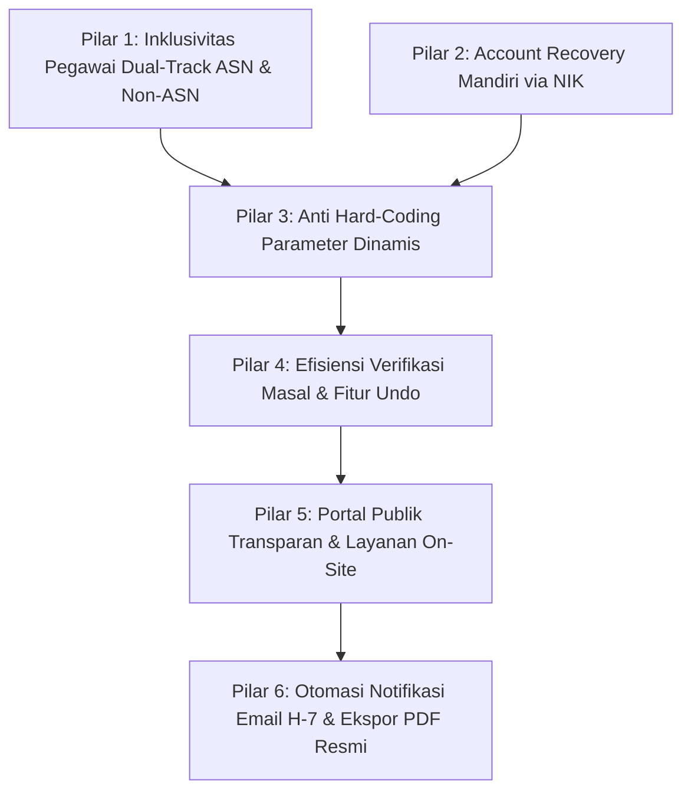

# LAPORAN ANALISIS KOMPREHENSIF PROYEK & RENCANA PENGEMBANGAN
## SISTEM MONITORING PENERBITAN TTE & PELAYANAN EMAIL DINAS RESMI (SISMON TTE - V6)
**Instansi:** Dinas Komunikasi dan Informatika (DKIS) / Bidang Persandian Pemerintah Kota Cirebon  
**Peneliti/Pengembang:** Ajria Jundan Jahid Idris (STMIK IKMI Cirebon / D3 Manajemen Informatika)  
**Status Repositori:** Produksi & Transisi Pembaruan V6.0 (`f:\sismon-tte-V6`)  
**Basis Framework:** Laravel 12/13 (PHP 8.3 FPM) • PostgreSQL 16 Enterprise • Redis 7 • Nginx Hardened • Zero-Trust VPN Gateway  

---

## 1. RINGKASAN EKSEKUTIF & PENGETAHUAN PROYEK

**SISMON TTE** adalah platform aplikasi web enterprise skala pemerintahan daerah yang dirancang untuk mengelola seluruh siklus hidup permohonan sertifikat **Tanda Tangan Elektronik (TTE)** tersertifikasi **Balai Sertifikasi Elektronik (BSrE) - Badan Siber dan Sandi Negara (BSSN)** serta standardisasi dan rekapitulasi akun email dinas resmi pemerintah berdomain `@cirebonkota.go.id`.

### Masalah Pokok yang Diselesaikan Sistem:
1. **Kepatuhan Regulasi Pelindungan Data Pribadi (UU PDP No. 27/2022):** Eliminasi penyimpanan teks mentah (*plaintext*) NIK 16 digit dan NIP 18 digit aparatur sipil negara.
2. **Trade-Off Enkripsi vs Kecepatan Kueri:** Memecahkan masalah hilangnya kemampuan pencarian kueri cepat pada data terenkripsi melalui implementasi *Deterministic HMAC-SHA256 Blind Indexing*.
3. **Standardisasi Email Dinas Berskala Kota:** Mengeliminasi kekeliruan pembuatan email dinas manual lewat generator usulan email terotomasi (`nama.nip@cirebonkota.go.id`) dan verifikasi rekapitulasi dua tahap.
4. **Pencegahan Kehabisan Memori Server (*Out-of-Memory / OOM*):** Mengatasi *memory exhaustion* saat mengekspor ratusan ribu data transaksi ke CSV menggunakan *Unbuffered FastCGI Cursor Streaming* (RAM konstan < 20 MB).
5. **Resiliensi Konektivitas Daerah Pelosok (Low-Bandwidth Engineering):** Menjamin formulir pendaftaran tetap dapat diakses di jaringan 2G/3G/Edge dengan prinsip *100% Zero External CDN*, *sessionStorage auto-save*, dan *Local Math CAPTCHA Fallback*.
6. **Perlindungan Perimeter Tanpa Kompromi (Zero-Trust VPN Gateway):** Menutup seluruh akses publik ke halaman autentikasi admin, mengalihkannya ke rute VPN terisolasi (`/gateway/login`) dengan respon *Stealth Mode* (HTTP 404 Not Found) bagi trafik luar.

---

## 2. ARSITEKTUR TEKNIS & STATUS IMPLEMENTASI EKSISTING

### 2.1 Komponen Basis Data & Kriptografi (PostgreSQL 16)
- **Tabel Inti:**
  - `skpd`: Master Satuan Kerja Perangkat Daerah dengan kuota populasi pegawai (`total_asn`) dan UUID v4.
  - `master_jabatan_golongan`: Master jabatan fungsional/struktural dan golongan ruang ASN.
  - `users`: IAM internal Superadmin Diskominfo dengan dukungan RFC 6238 TOTP MFA dan backup recovery codes terenkripsi.
  - `pendaftaran_tte`: Transaksi pengajuan TTE dengan enkripsi kolom, blind indexing, status FIFO, dan field fleksibel penempatan kerja (`deskripsi`).
  - `sertifikat_tte`: Manajemen sertifikat TTE aktif 2 tahun, pencatatan verifikator Tahap 2, dan status siklus hidup.
  - `dashboard_daily_stats`: Agregator statistik harian berkecepatan tinggi.
  - `security_audit_logs`: Audit trail terpartisi bulanan (`PARTITION BY RANGE (created_at)`) dengan fallback `security_audit_logs_default` dan indeks GIN.
- **Routing & Anti-Enumeration:**
  - Migrasi pengenal transaksi ke UUID v4 untuk mencegah eksploitasi OWASP Insecure Direct Object References (IDOR).
  - Penegakan *Partial Unique Index* pada NIK & NIP (`WHERE status != 'DITOLAK'`), mengizinkan ASN mengajukan ulang berkas yang sempat ditolak verifikator tanpa konflik data.

### 2.2 Lapisan Keamanan & Jaringan
- **Middleware `EnsureVpnAccess`:** Melakukan inspeksi bitwise subnet CIDR (`10.0.0.0/8`, `172.16.0.0/12`, `192.168.0.0/16`, `127.0.0.1/32`) pada `/gateway/login` dan `/admin/*`.
- **Stealth 404 Response:** Memblokir deteksi eksistensi rute admin oleh bot scanner internet publik.
- **Dua Tahap Verifikasi (Two-Stage Verification):**
  - *Tahap 1:* Verifikasi identitas dan penguncian email definitif (`email_final_terverifikasi`) via AJAX rekap email.
  - *Tahap 2:* Input nomor penerbitan sertifikat BSrE dan kalkulasi otomatis masa kedaluwarsa 2 tahun penuh.
- **Lifecycle Scanner 00:01 WIB:** Scheduler otomatis harian memindai masa berlaku sertifikat dan menaikkan status menjadi `WARNING_H7` (Peringatan H-7) serta `EXPIRED`.

### 2.3 Antarmuka & Frontend (Carbon Flat 0px UI)
- Mengadopsi bahasa desain **IBM Carbon Flat (0px border-radius)** tanpa pustaka pihak ketiga eksternal.
- Komponen *Searchable Live Combobox* pada formulir pendaftaran untuk memilih SKPD, Jabatan, dan Golongan.
- Modul dedikasi `/admin/capaian-skpd` untuk memantau capaian adopsi TTE seluruh SKPD se-Kota Cirebon secara transparan tanpa bias ukuran dinas.

---

## 3. RENCANA PENGEMBANGAN KE DEPAN (ROADMAP SISMON TTE V6)

Mengacu pada dokumen rencana implementasi mutakhir (`implementation.md`) hasil konsolidasi arahan Kepala Dinas dan kebutuhan operasional lintas bidang DKIS Kota Cirebon, proyek ini direncanakan bertransformasi melalui 6 pilar utama:

### 3.1 Pilar 1: Perluasan Inklusivitas Layanan (Jalur ASN & Non-ASN)
- **Kebutuhan:** Memfasilitasi pegawai Non-ASN (honorer, pegawai teknis, tenaga penunjang, BLUD/BUMD) yang membutuhkan sertifikat TTE dan email dinas.
- **Implementasi:**
  - Penambahan kolom `tipe_pegawai` (`'ASN'`, `'NON_ASN'`) pada tabel `pendaftaran_tte`.
  - Pelonggaran field `nip` menjadi `nullable` (hanya divalidasi keunikannya jika diisi).
  - Dukungan upload berkas bukti kepemilikan TTE aktif sebelumnya (`file_bukti_tte`).
  - Format usulan email fleksibel berbasis kombinasi angka/identitas.

### 3.2 Pilar 2: Fitur Pemulihan Akses Mandiri (*Account Recovery*)
- **Kebutuhan:** ASN seringkali lupa status sertifikatnya atau membutuhkan panduan re-aktivasi tanpa harus mendaftar ulang dari awal.
- **Implementasi:**
  - Endpoint publik `/recovery` dengan validasi NIK 16 digit dan nomor kontak terdaftar.
  - Pengecekan real-time kepemilikan sertifikat dan status email dinas.
  - Alur penerbitan tiket bantuan pemulihan akses secara terverifikasi.

### 3.3 Pilar 3: Mesin Parameter Kebijakan Dinamis (*Anti Hard-Coding*)
- **Kebutuhan:** Aturan operasional (masa berlaku sertifikat, batas hari peringatan, kuota batch masal) tidak boleh ditulis hardcoded pada kode program.
- **Implementasi:**
  - Pembuatan tabel `system_parameters` (`param_key`, `param_value`, `data_type`, `param_group`).
  - Service terpadu `App\Services\SystemParameterService` terintegrasi dengan Redis Cache.
  - Halaman konfigurasi admin di `/admin/settings/parameters`.
  - Nilai parameter awal: `cert_validity_years` (2), `cert_expiry_warning_days` (7), `bulk_verification_max_batch` (50).

### 3.4 Pilar 4: Efisiensi Verifikator & Mitigasi Human Error
- **Verifikasi Masal (*Bulk Verification & Validation*):**
  - Checkbox per-baris dan kontrol "Pilih Semua" (*Select All*) pada antrean Tahap 1 dan Tahap 2.
  - Eksekusi masal dalam transaksi atomik `DB::transaction` untuk menghemat waktu operator.
- **Pencarian Toleran Spasi & Multi-Sorting:**
  - Regex sanitasi spasi ganda dan pencarian per-digit NIK/NIP.
  - Opsi pengurutan multi-kriteria berdasarkan SKPD (A-Z/Z-A) dan Waktu Pengajuan (Asc/Desc).
- **Mekanisme Pembatalan & Mitigasi (*Undo & Double-Check*):**
  - Modal konfirmasi ganda interaktif sebelum aksi berdampak tinggi (tolak permohonan, revoke sertifikat).
  - Pencatatan snapshot perubahan ke tabel `audit_action_history`.
  - Fitur **Undo Revoke:** Tombol pemulihan sertifikat yang tidak sengaja dicabut kembali ke status `AKTIF`.

### 3.5 Pilar 5: Portal Publik Transparan & Layanan Kunjungan On-Site
- **Redesain Halaman Depan (`/`):**
  - Penyajian widget data agregat ketercapaian adopsi TTE se-Kota Cirebon secara terbuka kepada pimpinan dan publik.
  - Navigasi jelas menuju pendaftaran ASN, Non-ASN, atau Pemulihan Akun.
- **Modul Pengajuan Kunjungan Layanan TTE:**
  - Pembuatan tabel `pengajuan_kunjungan_layanan` untuk memfasilitasi SKPD yang meminta asistensi verifikasi dan penerbitan langsung di lokasi (*on-site visit*).
  - Pelacakan status permohonan kunjungan dengan nomor tiket unik.

### 3.6 Pilar 6: Otomasi Pelaporan & Notifikasi Terjadwal
- **Ekspor Dokumen Laporan PDF Resmi Siap Cetak:**
  - Controller `ExportLaporanPdfController` dengan template resmi (Kop Surat Diskominfo Kota Cirebon, stempel/identitas dinas, rekapitulasi data dan statistik).
  - Opsi filter multi-parameter: pilihan dinas spesifik dan rentang tanggal kustom.
- **Otomasi Notifikasi Kadaluarsa H-7 via Email:**
  - Artisan Command `php artisan tte:notify-expiring-h7` yang dijalankan setiap pagi (07:00 WIB) via Laravel Task Scheduler.
  - Otomatis mengirimkan surat peringatan perpanjangan ke alamat email pemohon yang akan kedaluwarsa tepat 7 hari lagi.
- **Modul Impor Data Historis (CSV/Excel Batch Importer):**
  - Service `ImportHistoricalDataAction` untuk mengimpor data kepegawaian dan kepemilikan sertifikat masa lalu secara instan tanpa input manual satu per satu.

---

## 4. TAHAPAN AKSI IMPLEMENTASI BERIKUTNYA

| Fase | Fokus Pekerjaan | Target Artefak Kode |
| :---: | :--- | :--- |
| **Fase 1** | Migrasi Skema Basis Data V6 | `create_system_parameters_table`, `create_pengajuan_kunjungan_layanan_table`, `create_audit_action_history_table`, alter kolom `tipe_pegawai` |
| **Fase 2** | Dynamic Parameter & Core Action | `SystemParameterService`, `StorePendaftaranAction` (dual-track), `BulkVerifikasiAction`, `UndoRevokeAction` |
| **Fase 3** | Redesain Antarmuka Publik & Dashboard | `views/public/landing.blade.php`, `views/public/pendaftaran.blade.php`, `views/admin/dashboard.blade.php` (widget ringkas & H-7) |
| **Fase 4** | Fitur Otomasi & Ekspor PDF | `ExportLaporanPdfController`, Artisan Command `tte:notify-expiring-h7`, bulk UI |
| **Fase 5** | Automated Testing & QA Hardening | Unit & Feature Tests PHPUnit untuk verifikasi dual-track, bulk action, undo revoke, dan ekspor PDF |
